<h2 align="center">DESENVOLVIMENTO INCIAL DE UM COPROCESSADOR GRÁFICO</h2>

<details><summary><h2 id="1-sobre-o-projeto"> 1. Sobre o projeto</h2></summary> 

Este repositório contém a implementação em Verilog do núcleo de um coprocessador gráfico de 16 bits, projetado para a placa de desenvolvimento Terasic DE1-SoC (Intel Cyclone V SoC). O projeto realiza a renderização de cenários baseados em tiles (background), sprites independentes e polígonos em tempo real a partir de instruções de 32 bits criadas pela equipe e enviadas pelo processador ARM sob o sistema operacional Linux. A comunicação entre o coprocessador gráfico e o processador ARM é regulada pelos sinais do tipo valid, busy e done. 

<details>
  <summary><h2>SUMÁRIO</h2></summary>

  - [1. Sobre o projeto](#1-sobre-o-projeto)
    - [1.1. Contribuidoras](#11-contribuidoras)
    - [1.2. Requisitos](#12-requisitos)
  - [2. Arquitetura do Sistema](#2-arquitetura-do-sistema)
    - [2.1. Arquitetura do Coprocessador Gráfico em Verilog](#21-arquitetura-do-coprocessador-gráfico-em-verilog)
    - [2.2. Diagrama de Alto Nível](#22-diagrama-de-alto-nível)
    - [2.3. Driver Assembly](#23-driver-assembly)
  - [3. Justificativa das Decisões de Projeto](#3-justificativa-das-decisões-de-projeto)
  - [4. Testes e Validação](#4-testes-e-validação)
    - [4.1. Teste Interativo](#41-teste-interativo)
    - [4.2. Teste Automatizado](#42-teste-automatizado)
    - [4.3. Códigos dos Testes](#43-códigos-dos-testes)
  - [5. Recursos Utilizados da FPGA](#5-recursos-utilizados-da-fpga)
  - [6. Gargalos e Limitações](#6-gargalos-e-limitações)
  - [7. Melhorias Futuras](#7-melhorias-futuras)
  - [8. Tecnologias Utilizadas](#8-tecnologias-utilizadas)
  - [9. Considerações Finais](#9-considerações-finais)
  - [10. Referências](#10-referências)

</details>

<br>

<h3 id="11-contribuidoras"> 1.1. CONTRIBUIDORAS</h3>
  
<div align="center">
  <a href="https://github.com/AnaluzLima"></a>
  <a href="https://github.com/matoslarissa5025-droid"></a>
  <a href="https://github.com/vivi2604"></a>
</div>

<h3 id="12-requisitos"> 1.2. REQUISITOS</h3>

O desenvolvimento do coprocessador gráfico deve cumprir:
- **Entrada e saída:**
  - A saída de vídeo deverá operar em 640 × 480 pixels, aproximadamente 60 Hz, por meio da interface VGA da DE1-SoC; ✅
  - A resolução lógica da cena deverá ser de 320 × 240 pixels, com duplicação de pixels na saída; ✅
  - Os botões, chaves e LEDs da placa usados exclusivamente para a demonstração do núcleo; ✅
    
- **Núcleo do coprocessador gráfico — Verilog:**
  - Todo o núcleo deverá ser descrito em Verilog; ✅
  - A arquitetura deverá ser modular; ✅
  - Todos os registradores e memórias deverão possuir estratégia definida de reinicialização ou inicialização; ✅
  - A saída não poderá apresentar instabilidade visual, perda de sincronismo ou pixels indefinidos após a inicialização; ✅
    
- **Motor de background:**
  - Implementar ao menos uma camada de background baseada em tilemap de 40 × 30 entradas; ✅
  - Utilizar tiles de 8 × 8 pixels armazenados em memória interna, com pelo menos 256 padrões disponíveis; ✅
  - Permitir deslocamento horizontal e vertical da camada, com tratamento de repetição ou recorte definido pela equipe; ✅
  - Gerar um índice de cor válido para cada pixel da região visível sem interromper o fluxo de vídeo; ✅
    
- **Motor de sprites:**
  - Disponibilizar memória de atributos para, no mínimo, 32 sprites; ✅
  - Suportar sprites de 16 × 16 pixels, podendo utilizar quatro tiles de 8 × 8 pixels para formar cada imagem; ✅
  - Cada sprite deverá possuir, no mínimo, posição X e Y, índice do padrão gráfico, habilitação, prioridade, espelhamento horizontal, espelhamento vertical e seleção de paleta; ✅
    
- **Rasterizador de polígonos:**
  - Implementar o desenho de triângulos e retângulos preenchidos; ✅
  - Utilizar aritmética inteira; ✅
  
- **Compositor, paleta e saída VGA:**
  - Combinar, a cada pixel, as contribuições do background, da camada de polígonos e dos sprites; ✅
  - Implementar pelo menos três níveis de prioridade entre as camadas; ✅
  - Aplicar transparência antes da seleção do pixel final; ✅
  - Converter o índice de 8 bits por meio de uma paleta programável de 256 entradas RGB; ✅

- Unidade de busca de instruções; ✅
- ISA de 32 bits; ✅
- Unidade de Controle; ✅
- Datapath; ✅
- Banco de registradores; ✅
- Registrador de status; ✅
- Mecanismo de sincronização com VGA; ✅
- Programa de demonstração; ✅

</details>

---

<details>
<summary><h2 id="2-arquitetura-do-sistema"> 2. Arquitetura do Sistema</h2></summary>

A arquitetura final do coprocessador gráfico é estruturada em blocos funcionais modulares que dividem de forma clara o domínio do gerenciamento das instruções recebidas, o domínio do desenho e o domínio da exibição física do vídeo.

<h3 id="21-arquitetura-do-coprocessador-gráfico-em-verilog"> 2.1. Arquitetura do Coprocessador Gráfico em Verilog</h3>

**2.1.1. Motor de background**

O Motor de Background aplica os parâmetros de deslocamento de rolagem e busca o índice de tile correspondente na memória RAM do Tilemap de 40x30.
- Recebe as coordenadas já na resolução de 320x240;
- Identifica o tipo de instrução que será realizada (<code>BSCROLL</code> ou <code>BTILE</code>);
- Particiona a instrução, gerando os dados necessários;
- Calcula o deslocamento vertical e horizontal;
- Divide a tela em um tilemap de 40x30;
- Calcula o endereço de qual tile o VGA está analisando no momento;
- Manda o endereço para a RAM e devolve a cor do tile;
- Caso a instrução seja para mudar um tile, <code>BTILE</code>, a RAM recebe os dados necessários para tal modificação e, posteriormente, o motor realiza os passos citados acima.

<br>

**2.1.2. Motor de Sprites**

O Motor de Sprites varre seu banco de dados para determinar se algum dos 32 sprites ativos intersecta a coordenada atual, calculando o espelhamento e o deslocamento horizontal ou vertical e acessando a cor do sprite na memória RAM.

- Pega as informações no banco de registradores de todos os 32 sprites e divide em diferentes barramentos;
- Verifica se o sprite está ativo no pixel atual;
- Analisa a ordem de prioridade dos sprites;
- Calcula o espelhamento vertical e horizontal de cada sprite;
- Calcula o endereço do sprite e acessa na memória para saber a cor do pixel;
- Manda o desenho do sprite;
- Caso a instrução seja para mudar o desenho de um sprite na RAM, <code>WRSP</code>, a RAM recebe os dados necessários para tal modificação e, posteriormente, o motor realiza os passos citados acima.

<br>

**2.1.3. Rasterizador de polígonos**

O rasterizador é responsável por:

- Avaliar simultaneamente o banco de registradores dos 16 polígonos ativos a cada pixel processado pelo Varredor Lógico Interno.
- Suportar a renderização de polígonos preenchidos com tipos pré-definidos em hardware (Retângulo, Quadrado, Triângulo Equilátero, Triângulo Isósceles e Triângulo Escaleno). A ISA permite atualizar dinamicamente a posição (X,Y), o tipo de forma (seletor da geometria), a cor de preenchimento, a prioridade e o estado de visibilidade do polígono no banco de registradores.
- Cálculo de Arestas: Transforma as coordenadas de entrada da varredura interna em números com sinal e executa em paralelo o teste de aresta (produtos vetoriais com sinal) correspondente ao tipo de polígono selecionado, identificando se a coordenada (X,Y) atual está dentro dos limites da forma geométrica.
- Gestão de Prioridades e Transparência: Em áreas onde ocorre sobreposição de múltiplos polígonos, avalia a ordem de prioridade definida nos registradores e envia a cor do polígono visível de maior prioridade para o Compositor.

<br>

**2.1.4. Unidade de Controle**

O módulo Unidade Controle atua como o núcleo de decodificação e controle de estados do coprocessador (FSM).

- **Ciclo de Busca e Execução**: Desenfileira as instruções da FIFO, interpreta os opcodes e distribui os operandos para as unidades funcionais apropriadas.
- **Atualização de Registradores**: Decodifica parâmetros de posição, cor, espelhamento, transparência e deslocamento, escrevendo diretamente nos bancos de registradores de cada motor gráfico (<code>RegSprites</code>, <code>RegPoligonos</code>, parâmetros de Background) ou atualizando as memórias BRAM (Tilemap e Sprite RAM).

<br>

**2.1.5. Fila de Instruções**

A Fila de Instruções é responsável por armazenar temporariamente as instruções de 32 bits enviadas pelo processador principal antes do processamento.

- **Mecanismo FIFO**: Opera como uma fila circular de entrada e saída em ordem de chegada, permitindo desacoplar a taxa de envio do processador hospedeiro da taxa de execução interna.
- **Sinais de Status**: Controla o fluxo de dados emitindo sinais de cheia (*full*) e vazia (*empty*), evitando *overflow* ou execuções indevidas quando não há instruções pendentes.

<br>

**2.1.6. ISA (Instruction Set Architecture)**

A ISA personalizada define o conjunto de instruções de 32 bits suportadas pelo coprocessador. Cada instrução possui um campo de opcode dedicado, seguido dos seus operandos.

- **Instruções de Sprites**: Configuração de coordenadas (X,Y), seleção de tile/imagem, espelhamento (horizontal/vertical), prioridade e visibilidade dos 32 sprites ativos.
- **Instruções de Polígonos**: Definição dos vértices, da cor, do tamanho e da prioridade dos 16 polígonos gerenciados pelo rasterizador.
- **Instruções de Background**: Ajuste de deslocamento (scroll) horizontal e vertical, além de escrita direta no Tilemap (40x30).

No total, tem-se 12 instruções que estão representadas abaixo: 

<div align="center">
  <figure>
    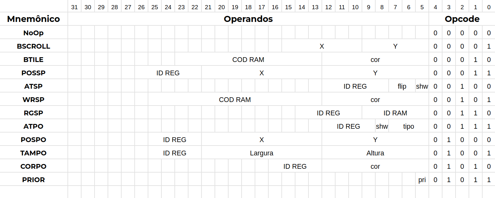
    <figcaption>
      Figura 1 - Instruções do Projeto.
    </figcaption>
  </figure>
</div>

<br></br>

**2.1.7. Compositor de Camadas**

Diferente da versão anterior (onde a composição era puramente combinacional antes da saída do VGA), no projeto atual o Compositor atua diretamente no fluxo do Varredor Lógico Interno antes da gravação na memória de vídeo:

- Avalia simultaneamente as saídas dos três motores (Background, Sprites e Polígonos) para a coordenada (X,Y) atual;
- Aplica a lógica de prioridade de camadas e transparência;
- Entrega o byte de cor de 8 bits resultante diretamente para ser gravado no Back Buffer.

<br>

**2.1.8. Top-Level**

O módulo Top-level integra e conecta todos os subsistemas do coprocessador:

- Conecta a recepção de instruções (via FIFO) à Unidade de Controle;
- Roteia os barramentos de registradores da Unidade de Controle para os Motores Gráficos;
- Interliga a saída combinada do Compositor aos FrameBuffers e sincroniza a leitura do Front Buffer com o Driver VGA.
- Gerencia os domínios de clock através do divisor de frequência, garantindo que o sinal base de 25 MHz alimente o sincronismo VGA, o varredor lógico e o controle síncrono das memórias M10K.

<br>

**2.1.9. Endereço VGA**

O Endereço VGA é um módulo simples responsável pelo cálculo do endereço a ser lido no Front Buffer.

- Recebe as coordenadas reais do VGA;
- Redimensiona a área lógica de trabalho de 640x480 para 320x240;
- Calcula o endereço da memória RAM do Front Buffer.

<br>

**2.1.10. Buffers de Vídeo**

O sistema adota uma arquitetura de Double Buffering (Front Buffer e Back Buffer) implementada em memórias Block RAM de duas portas (Dual-Port BRAM) para evitar tearing (corte de tela) e oscilações de imagem:

- **Back Buffer**: É a memória de destino de escrita contínua. A saída do Compositor é gravada nele à medida que o Varredor Lógico Interno processa os pixels (320x240);
- **Front Buffer**: É a memória de destino de leitura exclusiva do Driver VGA;
- **Alternância de Buffers**: A troca dos papéis de Front e Back Buffer ocorre exatamente no pulso de descida do sinal de sincronismo vertical (<code>VGA_VS</code>), durante o intervalo de apagamento vertical, garantindo que apenas quadros totalmente renderizados sejam exibidos na tela.

<h3 id="22-diagrama-de-alto-nível"> 2.2. Diagrama de Alto Nível</h3>

A Figura 2 abaixo apresenta a arquitetura do projeto estruturada em um Diagrama de Alto Nível.

<div align="center">
  <figure>
    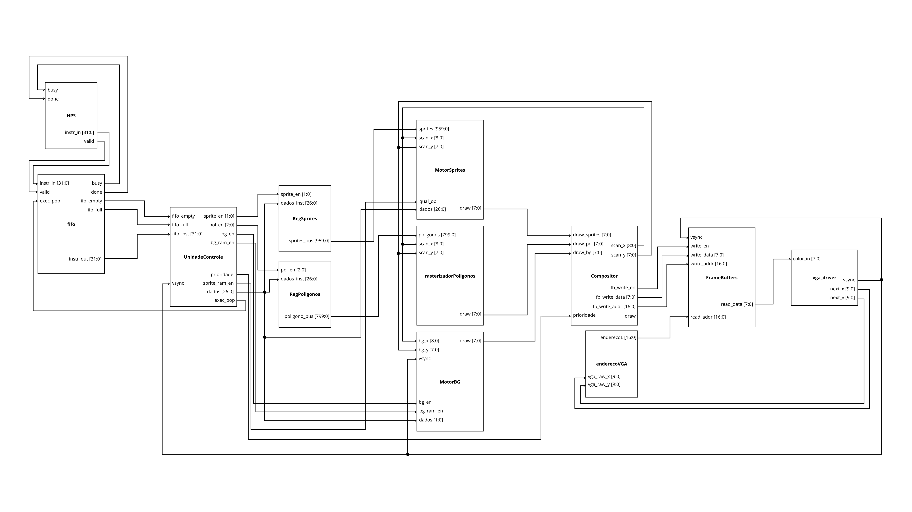
    <figcaption>
      Figura 2 - Diagrama de Alto Nível do Coprocessador.
    </figcaption>
  </figure>
</div>

<br></br>

<h3 id="23-driver-assembly"> 2.3. Driver Assembly</h3>

O driver em Assembly ARMv7-A (32 bits) implementa a camada de comunicação via MMIO entre o processador ARM Cortex-A9 (HPS) e o coprocessador gráfico na FPGA.

<br>

**2.3.1. Mapeamento de Memória (MMIO)**

O acesso ao hardware físico contorna o cache do sistema abrindo <code>/dev/mem</code> e mapeando a ponte Lightweight HPS-to-FPGA via syscall <code>mmap2</code>:

- **Endereço Base**: <code>0xFF200000</code> (espaço de 2 MB).
- **Offsets dos Registradores (PIOs)**:
  - <code>PIO_INST</code> (<code>0x00000</code>): Barramento de escrita da instrução (32 bits).
  - <code>PIO_BUSY</code> (<code>0x30000</code>): Entrada indicando ocupação da FIFO.
  - <code>PIO_DONE</code> (<code>0x40000</code>): Entrada sinalizando conclusão da operação na FPGA.
  - <code>PIO_VAL</code> (<code>0x50000</code>): Linha de strobe (valid) gerada pelo HPS.

<br>

**2.3.2. Protocolo de Handshake**

O envio síncrono de instruções na função <code>enviar_instrucao</code> segue um fluxo de 4 vias:
1. **Escrita do Comando**: O HPS escreve o dado em <code>PIO_INST</code>.
2. **Barreira de Memória**: Executa <code>dmb</code> e sobe a linha <code>PIO_VAL</code>.
3. **Reconhecimento da FPGA**: O hardware grava a instrução na FIFO e responde subindo <code>PIO_DONE</code>.
4. **Finalização**: O HPS abaixa <code>PIO_VAL</code> e aguarda <code>PIO_DONE</code> retornar a 0 para liberar a próxima chamada.

<br>

**2.3.3. Interface com C**

As funções criadas no driver podem ser importadas para serem utilizadas em códigos de outras linguagens, como no caso do C. Os procedimentos são:

- <code>int gpu_init(void)</code>: Mapeia o barramento de memória e zera os sinais de controle. Retorna 0 em caso de sucesso ou -1 se houver falha.
- <code>int enviar_instrucao(uint32_t instr)</code>: Transmite a instrução codificada via handshake. Possui um contador interno de timeout para evitar travamentos do sistema caso a placa seja resetada ou não responda.
- <code>void gpu_close(void)</code>: Desfaz o mapeamento da memória e encerra o driver.

</details>

---

<details>
<summary><h2 id="3-justificativa-das-decisões-de-projeto"> 3. Justificativa das Decisões de Projeto</h2></summary>

1. **Imunidade a Inconsistências Visuais**: A técnica de Double Buffering com troca de ponteiros no sincronismo vertical garante que o monitor VGA nunca leia uma tela sendo desenhada pela metade pelos motores, provendo estabilidade visual.
2. **Folga de Desempenho**: Ao desenhar um quadro inteiro em apenas 3,07 ms utilizando o clock de 25 MHz, o hardware consome menos de 20% do orçamento de tempo de varredura física do monitor (16,6 ms), assegurando alto desempenho e margem para fechamento de timing no Quartus.
3. **Aritmética Inteira Signed no Rasterizador**: Parametrizar as coordenadas e os cálculos dos multiplicadores DSP como números inteiros com sinal resolve erros de estouro aritmético quando vértices de polígonos móveis ou estáticos se localizam parcialmente fora do campo visível (coordenadas negativas), eliminando distorções na tela.
4. **Paralelismo de Alta Densidade**: O uso simultâneo de 87 blocos multiplicadores DSP dedicados garante que a validação lógica dos 16 polígonos ocorra em tempo real a cada pixel do varredor, sem atrasos de processamento.
5. **Reformulação do Compositor**: O problema tem como um dos requisitos o desenvolvimento de motores gráficos e compositor, entretanto, sabendo que as suas funcionalidades se assemelham, o compositor foi convertido em um seletor, sendo responsável apenas pela cor final do pixel, enquanto os motores são responsáveis pelos cálculos.
6. **Uso de uma Fila Circular de Instruções**: Uma fila circular é uma estrutura de dados que permite o reaproveitamento de espaço ao conectar a última posição com a primeira. Assim, com o uso de uma fila circular para o armazenamento das instruções, as chances de lotação são reduzidas, gerando uma atualização rápida na fila e evitando que novas instruções tenham que esperar para serem armazenadas. Entretanto, vale ressaltar que mais informações (ponteiros para indicar o volume de dados da fila) são necessárias para a manutenção da fila.
7. **Fases do Ciclo de Execução de Instrução**: Em arquiteturas de processadores, os ciclos de execução de instrução geralmente apresentam quatro fases: busca, decodificação, execução e armazenamento dos resultados. Porém, ao decorrer do desenvolvimento do coprocessador gráfico, percebeu-se a necessidade de modificação neste ciclo, assim, as fases de decodificação e execução foram unidas, já que os motores utilizam apenas um ciclo de clock para realizarem suas tarefas.
8. **Organização das Instruções**: xxx
9. **Uso da Busca Passiva de Instruções**: xxx


</details>

---

<details>
<summary><h2 id="4-testes-e-validação"> 4. Testes e Validação</h2></summary>

A validação do coprocessador gráfico foi estruturada em duas abordagens complementares de software em C executando sobre o Linux no processador ARM Cortex-A9 (HPS).

1. **Teste Interativo e Pontual**: Focado no isolamento de cada instrução individual da ISA, permitindo entrada manual de parâmetros e verificação passo a passo do comportamento lógico.
2. **Testes Automatizados e de Estresse**: Desenvolvidos pela Inteligência Artificial Claude para exercitar os limites de hardware do sistema, cobrindo cenários com 32 sprites em movimento, 16 polígonos simultâneos, rolagem contínua de plano de fundo, saturação de FIFO e medições temporais de vazão e taxa de quadros (FPS).

<h3 id="41-teste-interativo">4.1. Teste Interativo</h3>

Disponibiliza um menu no terminal que lê o opcode desejado e seus parâmetros decimais, empacota a palavra de 32 bits de acordo com a especificação e a despacha para o driver Assembly `enviar_instrucao`.

**4.1.1. Instruções**

- Instrução `BSCROLL`: Ajuste de deslocamento horizontal (X de 0 a 39) e vertical (Y de 0 a 29) da matriz de tiles de fundo.
- Instrução `BTILE`: Gravação de cor (0-255) em posições individuais da RAM de tiles (0-1199).
- Instruções de Sprites (`WRSP`, `RGSP`, `POSSP`, `ATSP`): Gravação de pixels na RAM de padrões, associação de registrador ao slot, posicionamento nas coordenadas (X, Y) e configuração de espelhamento (flips) e visibilidade (show).
- Instruções de Polígonos (`POSPO`, `TAMPO`, `ATPO`, `CORPO`): Posicionamento de âncora, definição de largura/altura, seleção de tipo geométrico (retângulo, quadrado, equilátero, isósceles, escaleno) e colorização dinâmica.
- Instrução `PRIOR`: Chaveamento dinâmico da prioridade do compositor entre a camada de polígonos e a camada de sprites.

<div align="center">
  <figure>
    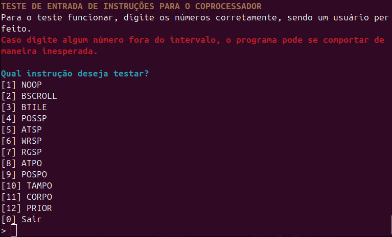
    <figcaption>
      Figura 3 - Terminal exibindo o Menu de seleção da Instrução a ser testada.
    </figcaption>
  </figure>
</div>

<br></br>


<h3 id="42-teste-automatizado">4.2. Teste Automatizado</h3>

A validação automatizada foi conduzida utilizando dois programas complementares gerados pelo Claude: o `testeClaude1.c`, voltado à validação visual de cenários gráficos complexos e estresse de renderização integrado ao driver Assembly, e o `testeClaude2.c`, realizado anteriormente a implementação do driver Assembly, mas que tem-se guardado o diagnóstico da interface HPS-FPGA e análise de desempenho.

**4.2.1. Teste Visual de Cenas e Estresse (`testeClaude1.c`)**

- **Cena 1 (NoOp / VSYNC / Opcodes Inválidos)**: Validação da sincronização de quadro (60 Hz, cerca de 16,7 ms) via borda de descida do sinal VSYNC e comprovação de imunidade a opcodes não implementados.
- **Cena 2 (BTILE - Fundo por Tiles)**: Preenchimento total do tilemap (1200 escritas) com padrões xadrez 1x1, 5x5, gradientes de cor e validação de extremidades da tela.

<div align="center">
  <figure>
    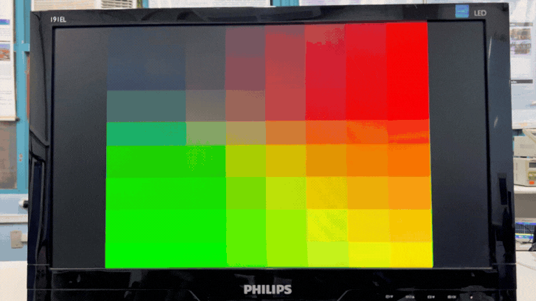
    <figcaption>
      Figura 4 - Alteração Dinâmica da RAM de Tiles.
    </figcaption>
  </figure>
</div>

<br></br>

- **Cena 3 (BSCROLL - Rolagem Contínua)**: Rolagem horizontal e vertical contínuo de tiles.

<div align="center">
  <figure>
    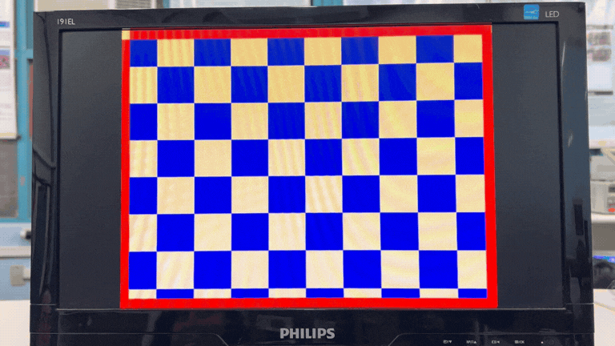
    <figcaption>
      Figura 5 - Rolagem Horizontal, Vertical e Diagonal dos Tiles.
    </figcaption>
  </figure>
</div>

<br></br>

- **Cena 4 (Sprites Individuais)**: Verificação de escrita na RAM de sprites, espelhamentos horizontal e vertical, posicionamento nos 4 cantos e transparência de cor <code>0x00</code>.

<div align="center">
  <figure>
    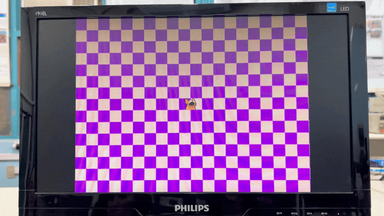
    <figcaption>
      Figura 6 - Testes das Instruções de Alteração dos Sprites.
    </figcaption>
  </figure>
</div>

<br></br>

- **Cena 5 (32 Sprites Simultâneos)**: Alocação de todos os 32 registradores de sprites com trajetórias e velocidades independentes, avaliando consistência sem perda de objetos na tela.

<div align="center">
  <figure>
    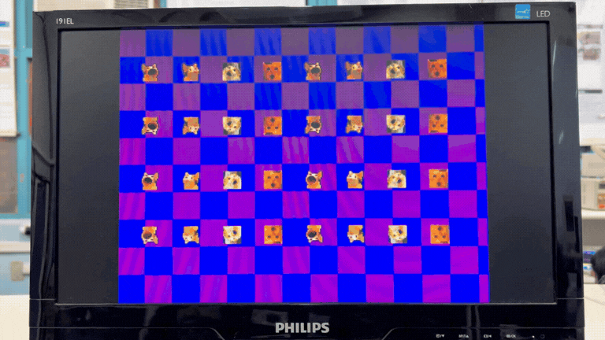
    <figcaption>
      Figura 7 - Testes de Alteração dos 32 Sprites Simultaneamente.
    </figcaption>
  </figure>
</div>

<br></br>

- **Cena 6 (RAM de Sprites Cheia)**: Gravação massiva dos 32 slots da memória de sprites (32 * 256 = 8.192 instruções WRSP consecutivas) e remapeamento dinâmico via RGSP.

- **Cena 7 (Polígonos Individuais)**: Rasterização em tempo real das 5 formas geométricas suportadas (retângulo, quadrado, triângulos equilátero, isósceles e escaleno), com testes de redimensionamento (TAMPO) e transparência.
  
<div align="center">
  <figure>
    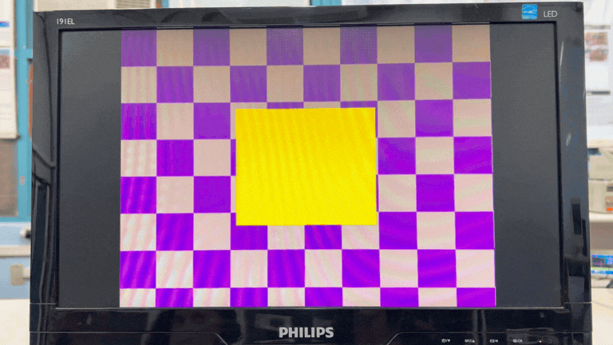
    <figcaption>
      Figura 8 - Testes das Instruções de Alteração dos Polígonos.
    </figcaption>
  </figure>
</div>

<br></br>

- **Cena 8 (16 Polígonos Simultâneos)**: Renderização de 16 formas orbitando e validação do codificador de prioridade interno.

<div align="center">
  <figure>
    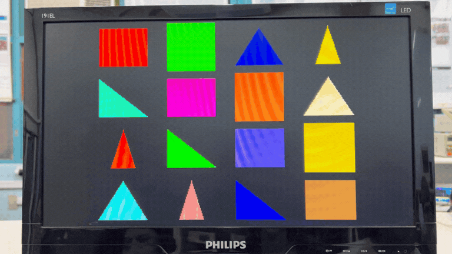
    <figcaption>
      Figura 9 - Testes de Criação e Movimentação de 16 Polígonos Simultaneamente.
    </figcaption>
  </figure>
</div>

<br></br>

- **Cena 9 (Prioridade de Camadas - PRIOR)**: Sobreposição direta de polígonos e sprites, alternando o registrador de prioridade em tempo real.

<div align="center">
  <figure>
    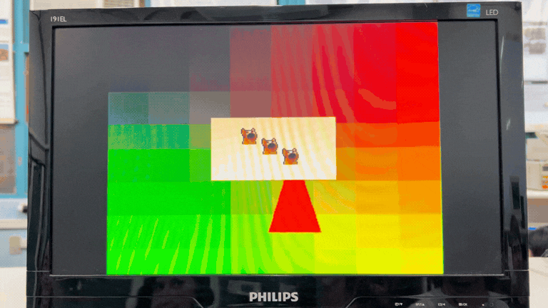
    <figcaption>
      Figura 10 - Testes de Prioridade Entre os Motores.
    </figcaption>
  </figure>
</div>

<br></br>

- **Cena 10 (Cenário Completo Integrado)**: Execução por 600 quadros, combinando rolagem de fundo, 16 polígonos em órbita, 32 sprites em movimento e comutação periódica de prioridade.

<div align="center">
  <figure>
    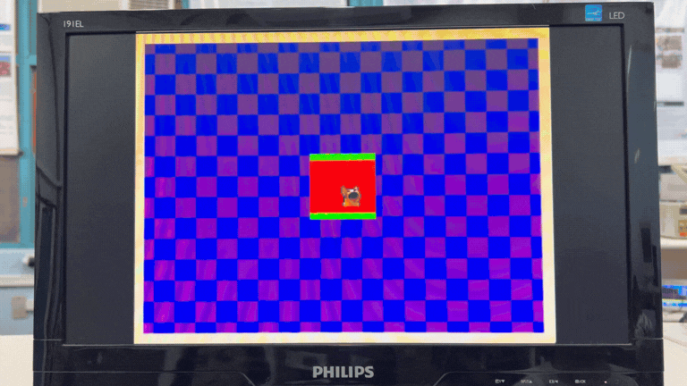
    <figcaption>
      Figura 11 - Teste de Alteração dos Três Motores em conjunto.
    </figcaption>
  </figure>
</div>

<br></br>

- **Cena 11 (Teste de Estresse Bruto)**: Despacho ininterrupto de 30.000 instruções aleatórias válidas sem inserção de NoOp para validar a saturação da FIFO de entrada e robustez do handshake contra deadlock.

**4.2.2. Diagnóstico de Comunicação e Resultados de Desempenho (`TesteClaude2.c`)**

Para extrair métricas temporais de cada instrução e auditar a camada física de comunicação entre o HPS e a FPGA, foi executado o programa de diagnóstico `TesteClaude2.c` dividido em 8 fases. Ao todo, foram despachadas **4.091 instruções** monitoradas individualmente no terminal, comprovando a estabilidade do canal MMIO via ponte Lightweight HPS-to-FPGA:

- **Fase 0 - Integridade da Ponte MMIO e Handshake:**
  - **Repouso dos Registradores:** Imediatamente após a liberação do reset (`KEY0`), as linhas de controle estabilizaram em `valid=0`, `busy=0` e `done=0`.
  - **Loopback de Barramento (32 bits):** Padrões binários de estresse injetados no registrador `pio_instrucao` (`0xA5A5A5A5`, `0x5A5A5A5A`, `0xFFFFFFFF`, `0x00000001`, `0x80000000` e `0x00000000`) apresentaram 100% de correspondência na leitura de retorno, atestando a integridade física das trilhas AXI sem curtos ou bits flutuantes.
  - **Latência Unitária de Resposta:** Na primeira instrução despachada, o sinal `done` foi capturado imediatamente com latência de **7,1 µs**.
  - **Vazão Máxima do Barramento:** Durante o envio consecutivo de uma rajada de 1.000 instruções, o tempo total registrado foi de **3,49 ms**, estabelecendo uma taxa média de **3,5 µs por instrução** e uma vazão sustentada de **286.340 instruções/segundo**.

- **Fases 1 a 5 - Latência por Instrução das Unidades Funcionais:**
  - **Plano de Fundo (`BTILE` - Fase 1):** Preenchimento completo dos 1.200 tiles seguido da escrita individual nos 4 cantos (`col=0/39`, `lin=0/29`), confirmando o cálculo de endereçamento linear com latência entre **2,1 µs e 2,4 µs** por instrução.
  - **Rolagem (`BSCROLL` - Fase 2):** Atualização dos registradores de deslocamento horizontal (`0..39`) e vertical (`0..29`) sincronizados ao VSYNC com tempo de resposta entre **2,1 µs e 2,5 µs**.
  - **Polígonos (`TAMPO`, `POSPO`, `CORPO`, `ATPO` - Fase 3):** Configuração e movimentação contínua das 5 primitivas geométricas registrando confirmações estáveis entre **2,1 µs e 2,4 µs** (com pico pontual de **8,3 µs** devido ao escalonamento do Linux).
  - **Sprites (`WRSP`, `RGSP`, `POSSP`, `ATSP` - Fase 4):** Upload de 512 pixels para a RAM de sprites (2 * 256 `WRSP`), vinculação de slots, teste simultâneo das 4 combinações de espelhamento (`flipH` e `flipV`) e animação por 300 quadros com latência entre **2,1 µs e 2,5 µs**.
  - **Prioridade (`PRIOR` - Fase 5):** Alternância dinâmica de sobreposição entre sprite e polígono concluída em **2,1 µs a 2,2 µs**.

- **Fase 6 - Dinâmica da FIFO e Mecanismo de Backpressure:**
  - O estresse da fila interna de 16 posições com o envio o mais rápido possível de 24 comandos `NOOP` (em que cada `NOOP` retém a Unidade de Controle até o próximo VSYNC, cerca de 16,7 ms) comprovou o controle de fluxo por bloqueio.
  - As 17 primeiras instruções foram absorvidas instantaneamente pelo hardware (16 alocadas na fila circular somadas a 1 em execução na Unidade de Controle).
  - O envio **18** foi exatamente o primeiro a ser retido pelo handshake (aguardando **3,8 ms**), comprovando experimentalmente o dimensionamento da arquitetura (`16 na fila + 1 na UC`).
  - O lote de 24 instruções foi completamente drenado em **104,7 ms**, valor perfeitamente alinhado ao tempo esperado de cerca de 7 quadros de vídeo a 60 Hz (aproximadamente 117 ms).

- **Fase 7 e Resumo Global:**
  - A rotina encerrou limpando os elementos visuais e restaurando os registradores de controle, totalizando **4.091 instruções enviadas** sem nenhum erro de comunicação, com tempo médio global até o sinal `done` de **2.757,7 µs** (média ponderada pelas esperas intencionais de sincronismo de quadro dos comandos `NOOP`).

<h3 id="43-códigos-dos-testes">4.3. Códigos dos Testes</h3>

<details><summary><b>4.3.1. Teste Interativo</b></summary>

```
#include <stdio.h>
#include <stdlib.h>
#include <stdint.h>
#include <string.h>
#include <time.h>
#include <signal.h>


extern int gpu_init(void);
extern int enviar_instrucao(uint32_t instr);
extern void gpu_close(void);


#define LARGURA 320
#define ALTURA 240
#define TILES_X 40
#define TILES_Y 30
#define N_TILES (TILES_X * TILES_Y)
#define N_SPRITES 32
#define N_SPRITE_RAM 32
#define SPR_TAM 16
#define N_POLIGONOS 16


enum {NOOP, BSCROLL, BTILE, POSSP, ATSP, WRSP, RGSP, ATPO, POSPO, TAMPO, CORPO, PRIOR};


static inline uint32_t i_noop(void){
   return NOOP;
}
static inline uint32_t i_bscroll(unsigned x, unsigned y){
   return BSCROLL | ((x & 0x3Fu) << 10) | ((y & 0x1Fu) << 5);
}
static inline uint32_t i_btile(unsigned end, unsigned cor){
   return BTILE | ((end & 0x7FFu) << 13) | ((cor & 0xFFu) << 5);
}
static inline uint32_t i_possp(unsigned id, unsigned x, unsigned y){
   return POSSP | ((id & 0x1Fu) << 22) | ((x & 0x1FFu) << 13) | ((y & 0xFFu) << 5);
}
static inline uint32_t i_atsp(unsigned id, unsigned flipv, unsigned fliph, unsigned show){
   return ATSP | ((id & 0x1Fu) << 8) | ((flipv & 1u) << 7) | ((fliph & 1u) << 6) | ((show & 1u) << 5);
}
static inline uint32_t i_wrsp(unsigned end, unsigned cor) {
   return WRSP | ((end & 0x1FFFu) << 13) | ((cor & 0xFFu) << 5);
}
static inline uint32_t i_rgsp(unsigned id, unsigned slot){
   return RGSP | ((id & 0x1Fu) << 10) | ((slot & 0x1Fu) << 5);
}
static inline uint32_t i_atpo(unsigned id, unsigned tipo, unsigned show){
   return ATPO | ((id & 0xFu) << 9) | ((show & 1u) << 8) | ((tipo & 7u) << 5);
}
static inline uint32_t i_pospo(unsigned id, unsigned x, unsigned y){
   return POSPO | ((id & 0xFu) << 22) | ((x & 0x1FFu) << 13) | ((y & 0xFFu) << 5);
}
static inline uint32_t i_tampo(unsigned id, unsigned larg, unsigned alt){
   return TAMPO | ((id & 0xFu) << 22) | ((larg & 0x1FFu) << 13) | ((alt & 0xFFu) << 5);
}
static inline uint32_t i_corpo(unsigned id, unsigned cor){
   return CORPO | ((id & 0xFu) << 13) | ((cor & 0xFFu) << 5);
}
static inline uint32_t i_prior(unsigned p){
   return PRIOR | ((p & 1u) << 5);
}


static void enviar(uint32_t instr){
   if (enviar_instrucao(instr) != 0) fprintf(stderr, "ERRO: sem 'done' do coprocessador (instrucao 0x%08X)\n", instr);
}


int main(){
   if (gpu_init() != 0) {
       fprintf(stderr, "Erro ao inicializar a GPU\n");
       return EXIT_FAILURE;
   }


   int opcode;
   int x, y, id, cor, larg, alt, flipv, fliph, show, end, reg, slot, tipo, prioridade, tile, pol;
   printf("\033[1;33mTESTE DE ENTRADA DE INSTRUÇÕES PARA O COPROCESSADOR\033[m\n");
   printf("Para o teste funcionar, digite os números corretamente, sendo um usuário perfeito.\n");
   printf("\033[1;31mCaso digite algum número fora do intervalo, o programa pode se comportar de maneira inesperada.\033[m\n\n");


   while(1){
       printf("\033[1;36mQual instrução deseja testar?\033[m \n[1] NOOP\n[2] BSCROLL\n[3] BTILE\n[4] POSSP\n[5] ATSP\n[6] WRSP\n[7] RGSP\n[8] ATPO\n[9] POSPO\n[10] TAMPO\n[11] CORPO\n[12] PRIOR\n[0] Sair\n\033[m");
       scanf("%d", &opcode);


       printf("\n");


       switch(opcode){
           case 1:
               enviar(i_noop());
               break;
           case 2:
               printf("Digite os valores de x e y para BSCROLL (0-39 para x, 0-29 para y): \n");
              
               printf("X: ");
               scanf("%d", &x);


               printf("\nY: ");
               scanf("%d", &y);


               enviar(i_bscroll(x, y));
               break;
           case 3:
               printf("Digite o valor do tile que voce deseja mudar (0-1199): \n");
               scanf("%d", &tile);


               printf("\nDigite a cor do tile (0-255): \n");
               scanf("%d", &cor);
              
               enviar(i_btile(tile, cor));
               break;
           case 4:
               printf("Digite os valores de x e y para POSSP (0-319 para x, 0-239 para y): \n");
              
               printf("ID (0-31): \n");
               scanf("%d", &id);
              
               printf("X: \n");
               scanf("%d", &x);
              
               printf("Y: ");
               scanf("%d", &y);
              
               enviar(i_possp(id,x,y));
               break;
           case 5:
               printf("Digite os valores de flipv, fliph e show para ATSP (0 ou 1): \n");
              
               printf("ID (0-31): \n");
               scanf("%d", &id);
              
               printf("Flip Vertical (0 ou 1): \n");
               scanf("%d", &flipv);               
              
               printf("Flip Horizontal (0 ou 1): \n");
               scanf("%d", &fliph);
              
               printf("Show (0 ou 1): \n");
               scanf("%d", &show);
              
               enviar(i_atsp(id,flipv,fliph,show));
               break;
           case 6:
               printf("Digite o valor do endereço de WRSP (0-8191): \n");
              
               scanf("%d", &end);
              
               printf("Digite a cor do pixel (0-255): \n");
              
               scanf("%d", &cor);
              
               enviar(i_wrsp(end, cor));
               break;
           case 7:
              
               printf("Digite o valor do registrador (0-31): \n");
               scanf("%d", &reg);
              
               printf("Digite o valor do slot na RAM (0-31): \n");
               scanf("%d", &slot);


               enviar(i_rgsp(reg, slot));
               break;
           case 8:
               printf("Digite os valores de ID, tipo e show para ATPO: \n");
              
               printf("ID (0-15): \n");
               scanf("%d", &id);
              
               printf("\nTipo (0-4): \n");
               scanf("%d", &tipo);


               printf("\nShow (0 ou 1): \n");
               scanf("%d", &show);


               enviar(i_atpo(id, tipo, show));
               break;
           case 9:
               printf("Digite os valores de x e y para POSPO (0-319 para x, 0-239 para y): \n");


               printf("ID (0-15): \n");
               scanf("%d", &id);


               printf("X: ");
               scanf("%d", &x);


               printf("\nY: ");
               scanf("%d", &y);
              
               enviar(i_pospo(id, x, y));
               break;
           case 10:
               printf("Definindo o tamanho do polígono: \n");


               printf("ID (0-15): \n");
               scanf("%d", &id);
              
               printf("Largura (1-319): \n");
               scanf("%d", &larg);


               printf("\nAltura (1-239): \n");
               scanf("%d", &alt);


               enviar(i_tampo(id, larg, alt));
               break;
           case 11:
               printf("Definindo a cor do polígono: \n");


               printf("Poligono (0-15): \n");
               scanf("%d", &pol);
              
               printf("Cor (0-255): \n");
               scanf("%d", &cor);


               enviar(i_corpo(pol, cor));
               break;
           case 12:
               printf("Defina a prioridade entre os motorores:\n0. Sprite tem prioridade sobre polígono\n1. Polígono tem prioridade sobre sprite\n");
              
               scanf("%d", &prioridade);
              
               enviar(i_prior(prioridade));
               break;
           case 0:
               printf("Saindo...\n");
               gpu_close();
               return EXIT_SUCCESS;
           default:
               printf("Opção inválida. Tente novamente.\n");
       }
   }


   gpu_close();
   return EXIT_SUCCESS;
}

```
</details>


<details><summary><b>4.3.2. Teste Automatizado 1</b></summary>

```
/* ============================================================================
*  testeClaude1.c  -  Bateria de testes do coprocessador gráfico (DE1-SoC)
*
*  Compilar (C + driver assembly juntos):
*      gcc -O2 -Wall testeClaude1.c libAssembly.S -o teste -lrt
*  Executar (precisa de root por causa do /dev/mem):
*      sudo ./teste                 -> avança com ENTER (q+ENTER sai)
*      sudo ./teste -t 2000         -> avança sozinho a cada 2000 ms
*      sudo ./teste -c 5            -> roda só a cena 5
*      sudo ./teste -l              -> lista as cenas
*
*  Resolução lógica: 320x240 (o VGA mostra 640x480, cada pixel lógico = 2x2).
*  Cor: 8 bits RGB332 (RRRGGGBB).  Cor 0 = TRANSPARENTE em sprites/polígonos.
*
*  ISA (opcode nos bits [4:0], operandos nos bits [31:5]):
*    0 NoOp     espera o próximo VSYNC (usamos como "fim de quadro")
*    1 BSCROLL  X[15:10] Y[9:5]                       (X<=39, Y<=29: em tiles)
*    2 BTILE    ENDERECO[23:13] COR[12:5]             (endereço = linha*40+coluna)
*    3 POSSP    ID[26:22] X[21:13] Y[12:5]
*    4 ATSP     ID[12:8] FLIP_V[7] FLIP_H[6] SHOW[5]
*    5 WRSP     ENDERECO[25:13] COR[12:5]             (end = slot*256 + y*16 + x)
*    6 RGSP     ID[14:10] SLOT_RAM[9:5]
*    7 ATPO     ID[12:9] SHOW[8] TIPO[7:5]
*    8 POSPO    ID[25:22] X[21:13] Y[12:5]
*    9 TAMPO    ID[25:22] LARGURA[21:13] ALTURA[12:5]
*   10 CORPO    ID[16:13] COR[12:5]
*   11 PRIOR    PRI[5]    (0 = sprite sobre polígono, 1 = polígono sobre sprite)
*
*  Tipos de polígono: 0 retângulo, 1 quadrado (lado = largura), 2 triângulo
*  equilátero (X = vértice do topo, base ±L/2), 3 isósceles (X = topo, base ±L/4),
*  4 escaleno/retângulo (vértice reto embaixo à esquerda).
*  Menor ID = maior prioridade (sprite 0 e polígono 0 ficam por cima).
* ========================================================================== */


#include <stdio.h>
#include <stdlib.h>
#include <stdint.h>
#include <string.h>
#include <time.h>
#include <signal.h>


/* ---- driver assembly (assembly.S) ---------------------------------------- */
extern int  gpu_init(void);                    /* 0 ok, -1 erro           */
extern int  enviar_instrucao(uint32_t instr);  /* 0 ok, -1 erro/timeout   */
extern void gpu_close(void);


#ifdef SIM_HOOK                                /* só usado no simulador de bancada */
extern void sim_snapshot(const char *titulo);
#endif


/* ---- limites do hardware -------------------------------------------------- */
#define LARGURA        320
#define ALTURA         240
#define TILES_X        40
#define TILES_Y        30
#define N_TILES        (TILES_X * TILES_Y)     /* 1200 */
#define N_SPRITES      32
#define N_SPRITE_RAM   32                      /* 32 slots de 16x16 = 8192 bytes */
#define SPR_TAM        16
#define N_POLIGONOS    16


/* ---- opcodes -------------------------------------------------------------- */
enum { OP_NOOP, OP_BSCROLL, OP_BTILE, OP_POSSP, OP_ATSP, OP_WRSP, OP_RGSP,
      OP_ATPO, OP_POSPO, OP_TAMPO, OP_CORPO, OP_PRIOR };


/* ---- paleta RGB332 -------------------------------------------------------- */
#define COR_PRETO     0x00
#define COR_AZUL      0x03
#define COR_VERDE     0x1C
#define COR_CIANO     0x1F
#define COR_VERMELHO  0xE0
#define COR_MAGENTA   0xE3
#define COR_LARANJA   0xF0
#define COR_AMARELO   0xFC
#define COR_BRANCO    0xFF
#define COR_CINZA     0x92
#define COR_ROXO      0x62


/* ============================================================================
*  Codificadores de instrução (ISA nova, opcode em [4:0])
* ========================================================================== */
static inline uint32_t i_noop(void) { return OP_NOOP; }
static inline uint32_t i_bscroll(unsigned x, unsigned y)
{ return OP_BSCROLL | ((x & 0x3Fu) << 10) | ((y & 0x1Fu) << 5); }
static inline uint32_t i_btile(unsigned end, unsigned cor)
{ return OP_BTILE | ((end & 0x7FFu) << 13) | ((cor & 0xFFu) << 5); }
static inline uint32_t i_possp(unsigned id, unsigned x, unsigned y)
{ return OP_POSSP | ((id & 0x1Fu) << 22) | ((x & 0x1FFu) << 13) | ((y & 0xFFu) << 5); }
static inline uint32_t i_atsp(unsigned id, unsigned flipv, unsigned fliph, unsigned show)
{ return OP_ATSP | ((id & 0x1Fu) << 8) | ((flipv & 1u) << 7) | ((fliph & 1u) << 6) | ((show & 1u) << 5); }
static inline uint32_t i_wrsp(unsigned end, unsigned cor)
{ return OP_WRSP | ((end & 0x1FFFu) << 13) | ((cor & 0xFFu) << 5); }
static inline uint32_t i_rgsp(unsigned id, unsigned slot)
{ return OP_RGSP | ((id & 0x1Fu) << 10) | ((slot & 0x1Fu) << 5); }
static inline uint32_t i_atpo(unsigned id, unsigned tipo, unsigned show)
{ return OP_ATPO | ((id & 0xFu) << 9) | ((show & 1u) << 8) | ((tipo & 7u) << 5); }
static inline uint32_t i_pospo(unsigned id, unsigned x, unsigned y)
{ return OP_POSPO | ((id & 0xFu) << 22) | ((x & 0x1FFu) << 13) | ((y & 0xFFu) << 5); }
static inline uint32_t i_tampo(unsigned id, unsigned larg, unsigned alt)
{ return OP_TAMPO | ((id & 0xFu) << 22) | ((larg & 0x1FFu) << 13) | ((alt & 0xFFu) << 5); }
static inline uint32_t i_corpo(unsigned id, unsigned cor)
{ return OP_CORPO | ((id & 0xFu) << 13) | ((cor & 0xFFu) << 5); }
static inline uint32_t i_prior(unsigned p)
{ return OP_PRIOR | ((p & 1u) << 5); }


/* ============================================================================
*  Infraestrutura: envio, tempo, interação com o terminal
* ========================================================================== */
static int           g_tempo_ms = -1;          /* -1 = espera ENTER; >=0 = timer */
static unsigned long g_enviadas = 0;
static volatile sig_atomic_t g_sair = 0;


static double agora_ms(void)
{
   struct timespec ts;
   clock_gettime(CLOCK_MONOTONIC, &ts);
   return ts.tv_sec * 1000.0 + ts.tv_nsec / 1e6;
}


static void dormir_ms(int ms)
{
   struct timespec ts;
   ts.tv_sec  = ms / 1000;
   ts.tv_nsec = (long)(ms % 1000) * 1000000L;
   nanosleep(&ts, NULL);
}


static void on_sigint(int s) { (void)s; g_sair = 1; }


static void limpar_tela(void);


static void sair_limpo(void)
{
   limpar_tela();
   gpu_close();
   printf("\nEncerrado. %lu instruções enviadas.\n", g_enviadas);
   exit(0);
}


/* envia 1 instrução; se o handshake estourar o timeout, aborta com diagnóstico */
static void enviar(uint32_t instr)
{
   if (enviar_instrucao(instr) != 0) {
       fprintf(stderr,
           "\nERRO: sem 'done' do coprocessador (instrução #%lu = 0x%08X).\n"
           "      O bitstream (.sof) está carregado? O reset (KEY0) está solto?\n",
           g_enviadas, instr);
       gpu_close();
       exit(1);
   }
   g_enviadas++;
}


/* fim de quadro: o NoOp faz a UC esperar o VSYNC (~16,7 ms a 60 Hz) */
static void frame(void)
{
   if (g_sair) sair_limpo();
   enviar(i_noop());
}


static void frames(int n) { while (n-- > 0) frame(); }


/* descreve o que deve aparecer e espera ENTER ou o timer */
static void esperar(const char *titulo, const char *esperado)
{
#ifdef SIM_HOOK
   sim_snapshot(titulo);
#endif
   printf("\n  [%s]\n      esperado: %s\n", titulo, esperado);
   if (g_tempo_ms >= 0) {
       printf("      (avanca em %d ms)\n", g_tempo_ms);
       fflush(stdout);
       dormir_ms(g_tempo_ms);
   } else {
       char buf[16];
       printf("      ENTER = continuar | q+ENTER = sair > ");
       fflush(stdout);
       if (!fgets(buf, sizeof buf, stdin) || buf[0] == 'q' || buf[0] == 'Q')
           g_sair = 1;
   }
   if (g_sair) sair_limpo();
}


/* ---- utilidades numéricas (sem libm: o gcc do lab não usa -lm) ------------ */
static const int8_t SEN[64] = {
     0,  12,  25,  37,  49,  60,  71,  81,  90,  98, 106, 112, 117, 122, 125, 126,
   127, 126, 125, 122, 117, 112, 106,  98,  90,  81,  71,  60,  49,  37,  25,  12,
     0, -12, -25, -37, -49, -60, -71, -81, -90, -98,-106,-112,-117,-122,-125,-126,
  -127,-126,-125,-122,-117,-112,-106, -98, -90, -81, -71, -60, -49, -37, -25, -12 };
static int isen(int i) { return SEN[i & 63]; }
static int icos(int i) { return SEN[(i + 16) & 63]; }


static int clampi(int v, int lo, int hi) { return v < lo ? lo : (v > hi ? hi : v); }


/* onda triangular 0..max..0 (para "quicar" sem if's) */
static int tri(int t, int max)
{
   int p;
   if (max <= 0) return 0;
   p = t % (2 * max);
   if (p < 0) p += 2 * max;
   return p <= max ? p : 2 * max - p;
}


static uint32_t g_rnd = 12345u;
static uint32_t rnd(void) { g_rnd = g_rnd * 1664525u + 1013904223u; return g_rnd >> 8; }


/* ============================================================================
*  Funções de alto nível sobre a ISA
* ========================================================================== */


/* ---- background ----------------------------------------------------------- */
static void bg_tile(int tx, int ty, unsigned cor) { enviar(i_btile(ty * TILES_X + tx, cor)); }


static void bg_preencher(unsigned cor)
{
   int i;
   for (i = 0; i < N_TILES; i++) enviar(i_btile(i, cor));
}


static void bg_xadrez(unsigned c1, unsigned c2, int lado)
{
   int tx, ty;
   for (ty = 0; ty < TILES_Y; ty++)
       for (tx = 0; tx < TILES_X; tx++)
           bg_tile(tx, ty, (((tx / lado) + (ty / lado)) & 1) ? c1 : c2);
}


static void bg_gradiente(void)       /* R cresce em X, G cresce em Y */
{
   int tx, ty;
   for (ty = 0; ty < TILES_Y; ty++)
       for (tx = 0; tx < TILES_X; tx++)
           bg_tile(tx, ty, (((tx * 8 / TILES_X) << 5) | ((ty * 8 / TILES_Y) << 2) | 0x01));
}


static void bg_moldura(unsigned cor)
{
   int i;
   for (i = 0; i < TILES_X; i++) { bg_tile(i, 0, cor); bg_tile(i, TILES_Y - 1, cor); }
   for (i = 0; i < TILES_Y; i++) { bg_tile(0, i, cor); bg_tile(TILES_X - 1, i, cor); }
}


/* ---- sprites -------------------------------------------------------------- */
/* padrões 16x16 em ASCII: '.' transparente, letra = cor */
static const char *PAD_F[16] = {      /* "F" assimétrico: serve para ver os flips */
   "WWWWWWWWWW......", "WWWWWWWWWW......", "WW..............", "WW..............",
   "WW..............", "WWWWWWW.........", "WWWWWWW.........", "WW..............",
   "WW..............", "WW..............", "WW..............", "WW..............",
   "WW..............", "WW..............", "WW............RR", "WW............RR" };


static const char *PAD_CARINHA[16] = {
   "....YYYYYYYY....", "..YYYYYYYYYYYY..", ".YYYYYYYYYYYYYY.", ".YYYBBYYYYBBYYY.",
   "YYYYBBYYYYBBYYYY", "YYYYYYYYYYYYYYYY", "YYYYYYYYYYYYYYYY", "YYYYYYYYYYYYYYYY",
   "YYRYYYYYYYYYYRYY", "YYYRYYYYYYYYRYYY", ".YYYRRRRRRRRYYY.", ".YYYYYRRRRYYYYY.",
   ".YYYYYYYYYYYYYY.", "..YYYYYYYYYYYY..", "....YYYYYYYY....", "................" };


static unsigned letra_cor(char c)
{
   switch (c) {
   case 'W': return COR_BRANCO;   case 'R': return COR_VERMELHO;
   case 'G': return COR_VERDE;    case 'B': return COR_AZUL;
   case 'Y': return COR_AMARELO;  case 'C': return COR_CIANO;
   case 'M': return COR_MAGENTA;  case 'O': return COR_LARANJA;
   default:  return COR_PRETO;
   }
}


/* padrões: 0=F  1=carinha  2=xadrez com furos  3=moldura com diagonais */
#define N_PADROES 4
static unsigned sprite_pixel(int padrao, int x, int y)
{
   switch (padrao) {
   case 0:  return letra_cor(PAD_F[y][x]);
   case 1:  return letra_cor(PAD_CARINHA[y][x]);
   case 2:  return (((x / 4) + (y / 4)) & 1) ? COR_CIANO : COR_PRETO;
   default:
       if (x == 0 || y == 0 || x == 15 || y == 15) return COR_VERDE;
       if (x == y || x + y == 15)                  return COR_AMARELO;
       return COR_PRETO;
   }
}


/* grava um padrão (256 WRSP) no slot da RAM de sprites */
static void sprite_carregar(int slot, int padrao)
{
   int x, y;
   for (y = 0; y < SPR_TAM; y++)
       for (x = 0; x < SPR_TAM; x++)
           enviar(i_wrsp(slot * 256 + y * SPR_TAM + x, sprite_pixel(padrao, x, y)));
}


/* sprite de slot "slot" com cor derivada do número (teste de RAM cheia) */
static unsigned slot_pixel(int slot, int x, int y)
{
   unsigned base = 0x20 + slot * 7;                    /* nunca é 0 */
   if (x == 0 || y == 0 || x == 15 || y == 15) return COR_BRANCO;
   if (x == y) return base ^ 0x24;
   return base;
}


static void sprite_carregar_slot_cheio(int slot)
{
   int x, y;
   for (y = 0; y < SPR_TAM; y++)
       for (x = 0; x < SPR_TAM; x++)
           enviar(i_wrsp(slot * 256 + y * SPR_TAM + x, slot_pixel(slot, x, y)));
}


static void sprite_pos(int id, int x, int y)
{
   enviar(i_possp(id, clampi(x, 0, LARGURA - 1), clampi(y, 0, ALTURA - 1)));
}


/* configura um sprite completo: slot da RAM, posição, flips e visibilidade */
static void sprite_cfg(int id, int slot, int x, int y, int flipv, int fliph, int show)
{
   enviar(i_rgsp(id, slot));
   sprite_pos(id, x, y);
   enviar(i_atsp(id, flipv, fliph, show));
}


/* ---- polígonos ------------------------------------------------------------ */
/* (x,y) = âncora do hardware (vértice A). Tipos 2 e 3: x = vértice do topo */
static void poligono(int id, int tipo, int x, int y, int larg, int alt, unsigned cor, int show)
{
   enviar(i_atpo(id, tipo, show));
   enviar(i_pospo(id, clampi(x, 0, LARGURA - 1), clampi(y, 0, ALTURA - 1)));
   enviar(i_tampo(id, larg, alt));
   enviar(i_corpo(id, cor));
}


/* posiciona pelo CENTRO da caixa envolvente (calcula a âncora de cada tipo) */
static void poligono_centro(int id, int tipo, int cx, int cy, int larg, int alt, unsigned cor)
{
   int h = (tipo == 1) ? larg : alt;                   /* quadrado: altura = largura */
   int x = (tipo == 2 || tipo == 3) ? cx : cx - larg / 2;
   poligono(id, tipo, x, cy - h / 2, larg, alt, cor, 1);
}


static void poligono_mover_centro(int id, int tipo, int cx, int cy, int larg, int alt)
{
   int h = (tipo == 1) ? larg : alt;
   int x = (tipo == 2 || tipo == 3) ? cx : cx - larg / 2;
   enviar(i_pospo(id, clampi(x, 0, LARGURA - 1), clampi(cy - h / 2, 0, ALTURA - 1)));
}


/* ---- limpar tudo ---------------------------------------------------------- */
static void limpar_tela(void)
{
   int i;
   for (i = 0; i < N_SPRITES; i++)   enviar(i_atsp(i, 0, 0, 0));
   for (i = 0; i < N_POLIGONOS; i++) enviar(i_atpo(i, 0, 0));
   enviar(i_prior(0));
   enviar(i_bscroll(0, 0));
   bg_preencher(COR_PRETO);
   frames(2);
}


/* ============================================================================
*  CENAS
* ========================================================================== */


/* ---- 1: NoOp / VSYNC / opcodes inválidos ---------------------------------- */
static void cena_noop(void)
{
   double t0, dt;
   const int N = 120;
   int i;


   limpar_tela();
   bg_gradiente();


   esperar("NoOp 1/3 - fundo de referência",
           "gradiente (vermelho cresce p/ direita, verde p/ baixo)");


   printf("      enviando %d NoOps (1 por quadro)...\n", N);
   t0 = agora_ms();
   for (i = 0; i < N; i++) frame();
   dt = agora_ms() - t0;
   printf("      %d NoOps em %.1f ms -> %.2f ms/quadro = %.2f fps (esperado ~16,7 ms / 60 fps)\n",
          N, dt, dt / N, 1000.0 * N / dt);


   esperar("NoOp 2/3 - opcodes inválidos",
           "imagem IDÊNTICA: opcodes 12, 13, 20 e 31 devem ser ignorados");
   enviar(12u | (0x1234567u << 5));
   enviar(13u | (0x7FFFFFFu << 5));
   enviar(20u | (0x0F0F0F0u << 5));
   enviar(31u | (0x7FFFFFFu << 5));
   frames(3);


   esperar("NoOp 3/3 - NoOps em rajada",
           "imagem continua igual; 40 NoOps seguidos (FIFO enche e a UC consome 1/quadro)");
   t0 = agora_ms();
   for (i = 0; i < 40; i++) frame();
   dt = agora_ms() - t0;
   printf("      40 NoOps em %.1f ms (%.2f ms/quadro)\n", dt, dt / 40);
}


/* ---- 2: BTILE -------------------------------------------------------------- */
static void cena_bg_tiles(void)
{
   int tx, ty;


   limpar_tela();


   bg_xadrez(COR_BRANCO, COR_AZUL, 1);
   frames(2);
   esperar("BTILE 1/4 - xadrez 1x1",
           "xadrez branco/azul de 40x30 tiles (cada tile 8x8 px)");


   bg_xadrez(COR_VERMELHO, COR_AMARELO, 5);
   frames(2);
   esperar("BTILE 2/4 - xadrez 5x5",
           "blocos de 5x5 tiles vermelho/amarelo");


   bg_gradiente();
   frames(2);
   esperar("BTILE 3/4 - gradiente",
           "R cresce da esquerda p/ direita, G de cima p/ baixo (todos os 1200 tiles)");


   bg_preencher(COR_PRETO);
   bg_moldura(COR_BRANCO);
   bg_tile(0, 0, COR_VERMELHO);             bg_tile(TILES_X - 1, 0, COR_VERDE);
   bg_tile(0, TILES_Y - 1, COR_AZUL);       bg_tile(TILES_X - 1, TILES_Y - 1, COR_AMARELO);
   for (tx = 0; tx < TILES_X; tx++) bg_tile(tx, TILES_Y / 2, COR_CIANO);
   for (ty = 0; ty < TILES_Y; ty++) bg_tile(TILES_X / 2, ty, COR_MAGENTA);
   frames(2);
   esperar("BTILE 4/4 - endereçamento",
           "moldura branca; cantos: sup-esq VERMELHO, sup-dir VERDE, inf-esq AZUL, inf-dir AMARELO; cruz ciano/magenta");
}


/* ---- 3: BSCROLL ------------------------------------------------------------ */
static void cena_bg_scroll(void)
{
   int i;


   limpar_tela();
   bg_xadrez(COR_BRANCO, COR_AZUL, 4);
   bg_moldura(COR_VERMELHO);
   bg_tile(0, 0, COR_AMARELO);
   frames(2);
   esperar("BSCROLL 1/4 - referência", "xadrez 4x4 com moldura vermelha e tile amarelo no canto sup-esq");


   for (i = 0; i < TILES_X; i++) { enviar(i_bscroll(i, 0)); frames(3); }
   esperar("BSCROLL 2/4 - horizontal 0..39",
           "o fundo andou 1 tile por 3 quadros p/ a ESQUERDA e fechou o ciclo (wrap)");


   for (i = 0; i < TILES_Y; i++) { enviar(i_bscroll(0, i)); frames(3); }
   esperar("BSCROLL 3/4 - vertical 0..29",
           "o fundo andou p/ CIMA 1 tile por 3 quadros e fechou o ciclo (wrap)");


   for (i = 0; i < 120; i++) { enviar(i_bscroll(i % TILES_X, (i * 2) % TILES_Y)); frames(1); }
   esperar("BSCROLL 4/4 - diagonal rápida",
           "movimento diagonal contínuo (120 quadros, 1 BSCROLL por quadro)");


   enviar(i_bscroll(TILES_X - 1, TILES_Y - 1));
   frames(2);
   esperar("BSCROLL - extremo (39,29)",
           "fundo deslocado no máximo: 1 tile antes do ciclo completo");
   enviar(i_bscroll(0, 0));
   frames(2);
}


/* ---- 4: sprites individuais ------------------------------------------------ */
static void cena_sprite_individual(void)
{
   int i, t;


   limpar_tela();
   bg_xadrez(COR_CINZA, COR_ROXO, 2);
   frames(2);


   sprite_carregar(0, 0);                              /* slot 0 = "F"      */
   sprite_carregar(1, 1);                              /* slot 1 = carinha  */
   sprite_carregar(2, 2);                              /* slot 2 = xadrez   */
   sprite_carregar(3, 3);                              /* slot 3 = moldura  */
   frames(1);
   printf("      (4 slots carregados: 4 x 256 WRSP)\n");


   sprite_cfg(0, 0, 152, 112, 0, 0, 1);
   frames(2);
   esperar("SPRITE 1/6 - POSSP+ATSP+RGSP+WRSP",
           "UM sprite 'F' branco (canto inferior direito vermelho) no centro da tela");


   sprite_cfg(0, 0,  60, 100, 0, 0, 1);
   sprite_cfg(1, 0, 100, 100, 0, 1, 1);
   sprite_cfg(2, 0, 140, 100, 1, 0, 1);
   sprite_cfg(3, 0, 180, 100, 1, 1, 1);
   frames(2);
   esperar("SPRITE 2/6 - flips",
           "4 'F': normal | espelhado H | espelhado V | H+V (marca vermelha muda de canto)");


   sprite_cfg(0, 0,   0,   0, 0, 0, 1);
   sprite_cfg(1, 1, 304,   0, 0, 0, 1);
   sprite_cfg(2, 2,   0, 224, 0, 0, 1);
   sprite_cfg(3, 3, 304, 224, 0, 0, 1);
   enviar(i_atsp(4, 0, 0, 0));
   frames(2);
   esperar("SPRITE 3/6 - cantos da tela",
           "4 sprites nos 4 cantos: F (sup-esq), carinha (sup-dir), xadrez ciano com furos (inf-esq), moldura verde (inf-dir)");


   sprite_cfg(0, 1, 144, 104, 0, 0, 1);
   sprite_cfg(1, 2, 150, 110, 0, 0, 1);
   sprite_cfg(2, 3, 156, 116, 0, 0, 1);
   sprite_cfg(3, 0, 162, 122, 0, 0, 1);
   frames(2);
   esperar("SPRITE 4/6 - sobreposição e transparência",
           "pilha diagonal: carinha por cima de tudo, depois xadrez (fundo aparece nos furos), moldura, F (sprite 0 = prioridade máxima)");


   printf("      movendo sprite 0 pelas bordas (300 quadros)...\n");
   sprite_cfg(0, 1, 0, 0, 0, 0, 1);
   sprite_cfg(1, 2, 8, 8, 0, 0, 0);
   enviar(i_atsp(2, 0, 0, 0));
   enviar(i_atsp(3, 0, 0, 0));
   for (t = 0; t < 300; t++) {
       sprite_pos(0, tri(t * 3, LARGURA - SPR_TAM), tri(t * 2, ALTURA - SPR_TAM));
       frame();
   }
   esperar("SPRITE 5/6 - movimento", "a carinha quicou pela tela inteira (sem rastro nem deformar)");


   for (i = 0; i < 8; i++) {
       enviar(i_atsp(0, 0, 0, i & 1));
       frames(30);
   }
   esperar("SPRITE 6/6 - show/hide", "carinha piscou 4 vezes (ATSP show=1/0); terminou escondida (i=7 -> show=1: visível)");
}


/* ---- 5: 32 sprites ao mesmo tempo ------------------------------------------ */
static void cena_sprites_max(void)
{
   int i, t;
   int px[N_SPRITES], py[N_SPRITES];


   limpar_tela();
   bg_xadrez(COR_AZUL, COR_ROXO, 3);
   for (i = 0; i < N_PADROES; i++) sprite_carregar(i, i);


   for (i = 0; i < N_SPRITES; i++) {
       px[i] = 20 + (i % 8) * 36;
       py[i] = 30 + (i / 8) * 48;
       sprite_cfg(i, i % N_PADROES, px[i], py[i], (i / 8) & 1, (i / 16) & 1, 1);
   }
   frames(2);
   esperar("32 SPRITES 1/3 - grade 8x4",
           "32 sprites (todos os IDs 0..31) em grade 8x4, 4 padrões repetidos, com flips variados");


   printf("      animando os 32 sprites (400 quadros)...\n");
   for (t = 0; t < 400; t++) {
       for (i = 0; i < N_SPRITES; i++)
           sprite_pos(i, tri(px[i] + t * (1 + i % 4), LARGURA - SPR_TAM),
                         tri(py[i] + t * (1 + i % 3), ALTURA - SPR_TAM));
       frame();
   }
   esperar("32 SPRITES 2/3 - movimento",
           "32 sprites quicando em velocidades diferentes, sem piscar nem perder nenhum");


   for (i = 0; i < N_SPRITES; i++) sprite_pos(i, 100 + i * 4, 60 + i * 3);
   frames(2);
   esperar("32 SPRITES 3/3 - prioridade entre sprites",
           "cascata diagonal: o sprite 0 (menor ID) fica por cima, o 31 por baixo");
}


/* ---- 6: RAM de sprites cheia ----------------------------------------------- */
static void cena_sprite_ram(void)
{
   int s;
   double t0, dt;


   limpar_tela();
   bg_preencher(COR_PRETO);


   printf("      gravando 32 slots x 256 pixels = 8192 WRSP...\n");
   t0 = agora_ms();
   for (s = 0; s < N_SPRITE_RAM; s++) sprite_carregar_slot_cheio(s);
   dt = agora_ms() - t0;
   printf("      8192 instruções em %.1f ms -> %.2f us/instrução (%.0f instr/s)\n",
          dt, dt * 1000.0 / 8192.0, 8192.0 / (dt / 1000.0));


   for (s = 0; s < N_SPRITE_RAM; s++)
       sprite_cfg(s, s, 20 + (s % 8) * 36, 30 + (s / 8) * 48, 0, 0, 1);
   frames(2);
   esperar("RAM SPRITES - 32 slots",
           "32 quadrados com borda branca e uma diagonal, cada um de cor diferente (slot 0 = escuro ... slot 31)");


   for (s = 0; s < N_SPRITE_RAM; s++) enviar(i_rgsp(s, 31 - s));
   frames(2);
   esperar("RAM SPRITES - RGSP trocando slots",
           "as MESMAS 32 posições, agora com as cores em ordem invertida (RGSP religou id -> slot 31-id)");
}


/* ---- 7: polígonos individuais ---------------------------------------------- */
static void cena_poligonos_ind(void)
{
   static const char *NOME[5] = { "retângulo", "quadrado", "triângulo equilátero",
                                  "triângulo isósceles", "triângulo escaleno (retângulo)" };
   static const unsigned CORES[8] = { COR_VERMELHO, COR_LARANJA, COR_AMARELO, COR_VERDE,
                                      COR_CIANO, COR_AZUL, COR_MAGENTA, COR_BRANCO };
   int tipo, i, t;
   char msg[96];


   limpar_tela();
   bg_xadrez(COR_CINZA, COR_ROXO, 4);
   frames(2);


   for (tipo = 0; tipo < 5; tipo++) {
       poligono_centro(0, tipo, 160, 120, 120, 100, COR_AMARELO);
       frames(2);
       snprintf(msg, sizeof msg, "POLIGONO 1/5 - tipo %d", tipo);
       esperar(msg, NOME[tipo]);
   }


   poligono_centro(0, 0, 160, 120, 120, 100, COR_VERMELHO);
   for (i = 0; i < 8; i++) { enviar(i_corpo(0, CORES[i])); frames(30); }
   esperar("POLIGONO 2/5 - CORPO", "retângulo mudou de cor 8 vezes (vermelho..branco)");


   enviar(i_corpo(0, COR_PRETO));
   frames(2);
   esperar("POLIGONO 3/5 - cor 0", "retângulo SUMIU (cor 0 = transparente) - o xadrez aparece no lugar");
   enviar(i_corpo(0, COR_VERDE));


   for (t = 8; t <= 200; t += 2) { enviar(i_tampo(0, t * 3 / 2, t / 2 + 20)); frame(); }
   for (t = 200; t >= 8; t -= 2) { enviar(i_tampo(0, t * 3 / 2, t / 2 + 20)); frame(); }
   esperar("POLIGONO 4/5 - TAMPO", "o retângulo verde cresceu e encolheu (ancorado no canto sup-esq)");


   enviar(i_tampo(0, 60, 40));
   for (t = 0; t < 300; t++) {
       enviar(i_pospo(0, tri(t * 2, LARGURA - 60), tri(t * 2, ALTURA - 40)));
       frame();
   }
   enviar(i_atpo(0, 0, 0));
   frames(2);
   esperar("POLIGONO 5/5 - POSPO e hide",
           "retângulo percorreu a tela e depois ESCONDEU (ATPO show=0): tela só com o xadrez");
}


/* ---- 8: 16 polígonos ao mesmo tempo ---------------------------------------- */
static void cena_poligonos_max(void)
{
   static const unsigned COR[16] = {
       COR_VERMELHO, COR_VERDE, COR_AZUL, COR_AMARELO, COR_CIANO, COR_MAGENTA,
       COR_LARANJA, COR_BRANCO, 0xE8, 0x3C, 0x6F, 0xB4, 0x5B, 0xD2, 0x27, 0x8D };
   int i, t;


   limpar_tela();
   bg_preencher(COR_PRETO);


   for (i = 0; i < N_POLIGONOS; i++)
       poligono_centro(i, i % 5, 40 + (i % 4) * 80, 30 + (i / 4) * 60, 56, 44, COR[i]);
   frames(2);
   esperar("16 POLIGONOS 1/3 - grade 4x4",
           "16 formas (IDs 0..15), tipos 0-4 repetidos: retângulo, quadrado, equilátero, isósceles, escaleno");


   printf("      animando 16 polígonos (400 quadros)...\n");
   for (t = 0; t < 400; t++) {
       for (i = 0; i < N_POLIGONOS; i++)
           poligono_mover_centro(i, i % 5,
               160 + isen(t + i * 4) * 110 / 127 * (1 + (i & 1)) / 2 + icos(i * 4) * 40 / 127,
               120 + icos(t + i * 4) * 80 / 127, 56, 44);
       frame();
   }
   esperar("16 POLIGONOS 2/3 - movimento", "16 formas orbitando em fases diferentes, todas visíveis");


   for (i = 0; i < N_POLIGONOS; i++) poligono_centro(i, 0, 160 - i * 4, 120 - i * 3, 150 - i * 6, 120 - i * 5, COR[i]);
   frames(2);
   esperar("16 POLIGONOS 3/3 - prioridade",
           "retângulos concêntricos: o ID 0 (vermelho) é o MAIOR e fica por cima? NÃO - todos têm centro/tam. decrescentes; "
           "o vermelho (ID 0) está por cima de todos os outros nas áreas de sobreposição");
}


/* ---- 9: PRIOR (sprite x polígono) ------------------------------------------ */
static void cena_prioridade(void)
{
   int i;


   limpar_tela();
   bg_gradiente();
   sprite_carregar(0, 1);
   sprite_cfg(0, 0, 150, 110, 0, 0, 1);
   sprite_cfg(1, 0, 130, 100, 0, 0, 1);
   sprite_cfg(2, 0, 170, 120, 0, 0, 1);
   poligono(0, 0, 100, 90, 120, 60, COR_BRANCO, 1);
   poligono(1, 3, 180, 120, 100, 80, COR_VERMELHO, 1);


   enviar(i_prior(0));
   frames(2);
   esperar("PRIOR 0", "3 carinhas POR CIMA do retângulo branco e do triângulo vermelho");


   enviar(i_prior(1));
   frames(2);
   esperar("PRIOR 1", "polígonos POR CIMA das carinhas (carinhas somem onde cruzam as formas)");


   for (i = 0; i < 12; i++) { enviar(i_prior(i & 1)); frames(20); }
   esperar("PRIOR alternando", "a prioridade alternou 12 vezes (a cada 20 quadros); terminou com PRIOR=1");
}


/* ---- 10: tudo junto -------------------------------------------------------- */
static void cena_tudo_junto(void)
{
   static const unsigned COR[16] = {
       COR_VERMELHO, COR_VERDE, COR_AZUL, COR_AMARELO, COR_CIANO, COR_MAGENTA,
       COR_LARANJA, COR_BRANCO, 0xE8, 0x3C, 0x6F, 0xB4, 0x5B, 0xD2, 0x27, 0x8D };
   const int N = 600;
   unsigned long inst0;
   double t0, dt;
   int i, t;


   limpar_tela();
   bg_xadrez(COR_AZUL, COR_ROXO, 2);
   bg_moldura(COR_BRANCO);
   for (i = 0; i < N_PADROES; i++) sprite_carregar(i, i);
   for (i = 0; i < N_SPRITES; i++) sprite_cfg(i, i % N_PADROES, 160, 120, (i >> 2) & 1, (i >> 3) & 1, 1);
   for (i = 0; i < N_POLIGONOS; i++) poligono_centro(i, i % 5, 160, 120, 50, 40, COR[i]);
   frames(2);


   esperar("TUDO JUNTO", "vai rodar 600 quadros (~10 s): fundo rolando + 16 polígonos + 32 sprites + PRIOR alternando");


   inst0 = g_enviadas;
   t0 = agora_ms();
   for (t = 0; t < N; t++) {
       enviar(i_bscroll((t / 4) % TILES_X, (t / 8) % TILES_Y));
       for (i = 0; i < N_POLIGONOS; i++)
           poligono_mover_centro(i, i % 5,
               160 + isen(t + i * 4) * 100 / 127, 120 + icos(t * 2 + i * 4) * 70 / 127, 50, 40);
       for (i = 0; i < N_SPRITES; i++)
           sprite_pos(i, 152 + isen(t * (1 + i % 3) + i * 2) * 140 / 127,
                         112 + icos(t * (1 + i % 2) + i * 3) * 100 / 127);
       if (t % 120 == 0) enviar(i_prior((t / 120) & 1));
       frame();
   }
   dt = agora_ms() - t0;
   printf("      %d quadros em %.1f ms -> %.2f fps | %lu instruções (%.1f por quadro)\n",
          N, dt, 1000.0 * N / dt, g_enviadas - inst0, (double)(g_enviadas - inst0) / N);
   printf("      (fps ~60 = o coprocessador acompanhou o VGA com folga)\n");


   esperar("TUDO JUNTO - fim", "animação terminou sem travar; imagem final com tudo visível");
}


/* ---- 11: estresse ---------------------------------------------------------- */
static void cena_estresse(void)
{
   const int N = 30000;
   double t0, dt;
   int i;


   limpar_tela();
   printf("      enviando %d instruções aleatórias válidas (sem NoOp)...\n", N);
   t0 = agora_ms();
   for (i = 0; i < N; i++) {
       switch (rnd() % 11) {
       case 0:  enviar(i_bscroll(rnd() % TILES_X, rnd() % TILES_Y)); break;
       case 1:  enviar(i_btile(rnd() % N_TILES, rnd() & 0xFF)); break;
       case 2:  enviar(i_possp(rnd() % N_SPRITES, rnd() % LARGURA, rnd() % ALTURA)); break;
       case 3:  enviar(i_atsp(rnd() % N_SPRITES, rnd() & 1, rnd() & 1, rnd() & 1)); break;
       case 4:  enviar(i_wrsp(rnd() % 8192, rnd() & 0xFF)); break;
       case 5:  enviar(i_rgsp(rnd() % N_SPRITES, rnd() % N_SPRITE_RAM)); break;
       case 6:  enviar(i_atpo(rnd() % N_POLIGONOS, rnd() % 5, rnd() & 1)); break;
       case 7:  enviar(i_pospo(rnd() % N_POLIGONOS, rnd() % LARGURA, rnd() % ALTURA)); break;
       case 8:  enviar(i_tampo(rnd() % N_POLIGONOS, rnd() % 120, rnd() % 100)); break;
       case 9:  enviar(i_corpo(rnd() % N_POLIGONOS, rnd() & 0xFF)); break;
       default: enviar(i_prior(rnd() & 1)); break;
       }
   }
   dt = agora_ms() - t0;
   printf("      %d instruções em %.1f ms -> %.2f us/instrução (%.0f instr/s), sem timeout\n",
          N, dt, dt * 1000.0 / N, N / (dt / 1000.0));
   frames(2);
   esperar("ESTRESSE", "tela com lixo gráfico aleatório (esperado!): o que importa é não ter travado nem dado timeout");
}


/* ============================================================================
*  main
* ========================================================================== */
typedef struct { const char *nome; void (*func)(void); } Cena;


static const Cena CENAS[] = {
   { "NoOp / VSYNC / opcodes inválidos",     cena_noop },
   { "BTILE (fundo por tiles)",              cena_bg_tiles },
   { "BSCROLL (rolagem do fundo)",           cena_bg_scroll },
   { "Sprites individuais (POSSP/ATSP/RGSP/WRSP)", cena_sprite_individual },
   { "32 sprites simultâneos",               cena_sprites_max },
   { "RAM de sprites cheia (8192 WRSP)",     cena_sprite_ram },
   { "Polígonos individuais (ATPO/POSPO/TAMPO/CORPO)", cena_poligonos_ind },
   { "16 polígonos simultâneos",             cena_poligonos_max },
   { "PRIOR (sprite x polígono)",            cena_prioridade },
   { "Tudo junto (600 quadros)",             cena_tudo_junto },
   { "Estresse (30000 instruções)",          cena_estresse },
};
#define N_CENAS ((int)(sizeof CENAS / sizeof CENAS[0]))


static int validar_padroes(void)
{
   int y;
   for (y = 0; y < 16; y++)
       if (strlen(PAD_F[y]) != 16 || strlen(PAD_CARINHA[y]) != 16) {
           fprintf(stderr, "padrão de sprite com linha %d de tamanho errado\n", y);
           return -1;
       }
   return 0;
}


static void uso(const char *prog)
{
   int i;
   printf("uso: %s [-t ms] [-c cena] [-l]\n"
          "  -t ms   avança sozinho a cada ms milissegundos (padrão: espera ENTER)\n"
          "  -c N    roda só a cena N (1..%d)\n"
          "  -l      lista as cenas\n\ncenas:\n", prog, N_CENAS);
   for (i = 0; i < N_CENAS; i++) printf("  %2d  %s\n", i + 1, CENAS[i].nome);
}


int main(int argc, char **argv)
{
   int i, so_cena = 0;


   for (i = 1; i < argc; i++) {
       if (!strcmp(argv[i], "-t") && i + 1 < argc)      g_tempo_ms = atoi(argv[++i]);
       else if (!strcmp(argv[i], "-c") && i + 1 < argc) so_cena = atoi(argv[++i]);
       else { uso(argv[0]); return !strcmp(argv[i], "-l") ? 0 : 1; }
   }
   if (so_cena < 0 || so_cena > N_CENAS) { uso(argv[0]); return 1; }
   if (validar_padroes() != 0) return 1;


   signal(SIGINT, on_sigint);


   if (gpu_init() != 0) {
       fprintf(stderr, "ERRO: gpu_init falhou (rode com sudo; /dev/mem precisa abrir e mapear a ponte).\n");
       return 1;
   }
   printf("Coprocessador gráfico - bateria de testes (%d cenas). Ctrl+C sai limpando a tela.\n", N_CENAS);


   for (i = 0; i < N_CENAS; i++) {
       if (so_cena && so_cena != i + 1) continue;
       printf("\n==================== CENA %d/%d: %s ====================\n",
              i + 1, N_CENAS, CENAS[i].nome);
       CENAS[i].func();
   }


   printf("\nTodas as cenas concluídas.\n");
   sair_limpo();
   return 0;
}

```
</details>


<details><summary><b>4.3.3. Teste Automatizado 2</b></summary>

```
/* =====================================================================
 * testeClaude2.c
 * Teste de comunicação HPS (ARM/Linux) -> coprocessador gráfico (FPGA)
 * DE1-SoC  |  TEC 499 - MI Sistemas Digitais  |  Problema 2
 *
 * O que faz:
 *   Envia instruções da ISA do coprocessador pela ponte Lightweight
 *   HPS-to-FPGA usando o handshake valid/busy/done da FIFO, e deixa você
 *   ACOMPANHAR cada instrução rodando, de duas formas:
 *     - modo manual (padrão): cada instrução só é enviada quando você
 *       aperta ENTER/espaço no terminal;
 *     - modo automático (-t ms): um temporizador avança sozinho.
 *
 * Compilar na placa:   gcc -O2 -Wall -o teste testeClaude2.c
 * Rodar (precisa root): sudo ./teste            (passo a passo)
 *                       sudo ./teste -t 400     (automático, 400 ms)
 *                       sudo ./teste -f 4       (só a fase 4)
 * Testar no PC (sem placa): make sim && ./teste_sim -t 1
 *
 * ANTES DE RODAR: o .sof precisa estar carregado na FPGA (acessar a
 * ponte sem FPGA configurada trava o HPS) e a KEY0 solta (é o reset).
 *
 * Teclas: [ENTER/espaço] avança   [a] alterna manual/automático
 *         [+] mais rápido  [-] mais lento  [p] pula a fase  [q] sai
 *
 * Esta é a camada que o driver Assembly vai substituir: tudo que está
 * em "enviar()" e nas funções mk_*()/i_*() é o que o driver ARM terá
 * que fazer a partir de uma única chamada em C.
 * ===================================================================== */
#define _POSIX_C_SOURCE 200809L
#define _DEFAULT_SOURCE
#include <stdio.h>
#include <stdlib.h>
#include <stdint.h>
#include <string.h>
#include <stdarg.h>
#include <unistd.h>
#include <fcntl.h>
#include <errno.h>
#include <signal.h>
#include <time.h>
#include <termios.h>
#include <sys/select.h>
#include <sys/mman.h>

/* ---------------------------------------------------------------------
 * Mapa de hardware (vem do hps_0.h gerado pelo Platform Designer)
 * ------------------------------------------------------------------- */
#define LW_BRIDGE_BASE 0xFF200000u
#define LW_BRIDGE_SPAN 0x00200000u   /* 2 MB: cobre até o pio_valid (0x50000) */

#if defined(__has_include)
#  if __has_include("hps_0.h")
#    include "hps_0.h"
#  endif
#endif
#ifndef PIO_INSTRUCAO_BASE
#  define PIO_INSTRUCAO_BASE 0x00000   /* HPS -> FPGA  (32 bits)  */
#endif
#ifndef PIO_BUSY_BASE
#  define PIO_BUSY_BASE      0x30000   /* FPGA -> HPS  (1 bit)    */
#endif
#ifndef PIO_DONE_BASE
#  define PIO_DONE_BASE      0x40000   /* FPGA -> HPS  (1 bit)    */
#endif
#ifndef PIO_VALID_BASE
#  define PIO_VALID_BASE     0x50000   /* HPS -> FPGA  (1 bit)    */
#endif

#define TIMEOUT_NS 1500000000ull       /* 1,5 s sem resposta = erro */

/* ---------------------------------------------------------------------
 * ISA do coprocessador: instrução de 32 bits
 *     [31:5] dados (27 bits)   [4:0] opcode
 * ------------------------------------------------------------------- */
enum {
    OP_NOP     = 0,   /* espera a borda de descida do vsync (sincroniza quadro) */
    OP_BSCROLL = 1,   /* dados: x[10:5] (6b)  y[4:0] (5b)                        */
    OP_BTILE   = 2,   /* dados: addr[18:8] (11b, 0..1199)  cor[7:0]              */
    OP_POSSP   = 3,   /* dados: id[21:17]  x[16:8] (9b)  y[7:0]                  */
    OP_ATSP    = 4,   /* dados: id[7:3]  flipV[2]  flipH[1]  show[0]             */
    OP_WRSP    = 5,   /* dados: addr[20:8] (13b = ram*256+y*16+x)  cor[7:0]      */
    OP_RGSP    = 6,   /* dados: id[9:5]  id_da_ram[4:0]                          */
    OP_ATPO    = 7,   /* dados: id[15:12]  show[11]  tipo[10:8]  cor[7:0]        */
    OP_POSPO   = 8,   /* dados: id[20:17]  x[16:8]  y[7:0]                       */
    OP_TAMPO   = 9,   /* dados: id[20:17]  largura[16:8]  altura[7:0]            */
    OP_CORPO   = 10,  /* dados: id[11:8]  cor[7:0] */
    OP_PRIOR   = 11   /* dados: bit0 da fatia de dados = bit5 da instrução */
};
enum { POL_RET = 0, POL_QUAD = 1, POL_EQUI = 2, POL_ISOS = 3, POL_ESCA = 4 };

/* cores RGB332 (cor 0 = transparente em sprites e polígonos) */
#define RGB332(r,g,b) ((uint8_t)((((r)&7)<<5)|(((g)&7)<<2)|((b)&3)))
#define COR_VERMELHO 0xE0
#define COR_VERDE    0x1C
#define COR_AZUL     0x03
#define COR_AMARELO  0xFC
#define COR_MAGENTA  0xE3
#define COR_BRANCO   0xFF
#define COR_CEU_A    RGB332(3,5,3)
#define COR_CEU_B    RGB332(2,4,3)
#define COR_GRAMA_A  RGB332(1,6,0)
#define COR_GRAMA_B  RGB332(1,5,0)

static inline uint32_t mk(unsigned op, uint32_t dados)
{
    return ((dados & 0x07FFFFFFu) << 5) | (op & 0x1Fu);
}

/* ---------------------------------------------------------------------
 * Camada de acesso aos PIOs (real, via /dev/mem, ou simulada com -DSIM)
 * ------------------------------------------------------------------- */
static uint64_t now_ns(void)
{
    struct timespec ts;
    clock_gettime(CLOCK_MONOTONIC, &ts);
    return (uint64_t)ts.tv_sec * 1000000000ull + (uint64_t)ts.tv_nsec;
}
#define BARREIRA() __sync_synchronize()

#ifndef SIM
/* ------------------------- hardware real ---------------------------- */
static volatile uint32_t *r_instr, *r_busy, *r_done, *r_valid;
static void *g_lw = MAP_FAILED;
static int   g_fd = -1;

static int hw_init(void)
{
    g_fd = open("/dev/mem", O_RDWR | O_SYNC);
    if (g_fd < 0) {
        perror("open(/dev/mem)");
        fprintf(stderr, "Dica: execute com sudo.\n");
        return -1;
    }
    g_lw = mmap(NULL, LW_BRIDGE_SPAN, PROT_READ | PROT_WRITE, MAP_SHARED,
                g_fd, LW_BRIDGE_BASE);
    if (g_lw == MAP_FAILED) {
        perror("mmap");
        close(g_fd);
        g_fd = -1;
        return -1;
    }
    r_instr = (volatile uint32_t *)((uint8_t *)g_lw + PIO_INSTRUCAO_BASE);
    r_busy  = (volatile uint32_t *)((uint8_t *)g_lw + PIO_BUSY_BASE);
    r_done  = (volatile uint32_t *)((uint8_t *)g_lw + PIO_DONE_BASE);
    r_valid = (volatile uint32_t *)((uint8_t *)g_lw + PIO_VALID_BASE);
    return 0;
}
static void hw_close(void)
{
    if (r_valid) *r_valid = 0;
    if (g_lw != MAP_FAILED) munmap(g_lw, LW_BRIDGE_SPAN);
    if (g_fd >= 0) close(g_fd);
    g_lw = MAP_FAILED;
    g_fd = -1;
    r_valid = NULL;
}
static inline void     hw_instr_write(uint32_t w) { *r_instr = w; }
static inline uint32_t hw_instr_read(void)        { return *r_instr; }
static inline uint32_t hw_busy(void)              { return *r_busy & 1u; }
static inline uint32_t hw_done(void)              { return *r_done & 1u; }
static inline uint32_t hw_valid_get(void)         { return *r_valid & 1u; }
static inline void     hw_valid_set(uint32_t v)   { *r_valid = v & 1u; }

#else
/* ---------------- modelo simulado (só para testar no PC) ------------ */
/* Imita a FIFO de 16 posições + UC: NOP segura a UC por 1 quadro (16,7 ms). */
static uint32_t sim_instr, sim_valid, sim_done;
static uint32_t sim_q[16];
static int      sim_cnt, sim_wait_low;
static uint64_t sim_free_at;

static void sim_update(void)
{
    uint64_t t = now_ns();
    while (sim_cnt > 0 && t >= sim_free_at) {
        uint32_t w = sim_q[0];
        memmove(&sim_q[0], &sim_q[1], (size_t)(15) * sizeof sim_q[0]);
        sim_cnt--;
        sim_free_at = ((w & 0x1F) == OP_NOP) ? t + 16666667ull : t;
    }
    if (!sim_wait_low && sim_valid && sim_cnt < 16) {
        sim_q[sim_cnt++] = sim_instr;
        sim_done = 1;
        sim_wait_low = 1;
    }
    if (sim_wait_low && !sim_valid) {
        sim_done = 0;
        sim_wait_low = 0;
    }
}
static int  hw_init(void)  { fprintf(stderr, "[SIM] modelo simulado, sem hardware\n"); return 0; }
static void hw_close(void) { sim_valid = 0; }
static inline void     hw_instr_write(uint32_t w) { sim_instr = w; }
static inline uint32_t hw_instr_read(void)        { return sim_instr; }
static inline uint32_t hw_busy(void)              { return 0; }
static inline uint32_t hw_done(void)              { sim_update(); return sim_done; }
static inline uint32_t hw_valid_get(void)         { return sim_valid; }
static inline void     hw_valid_set(uint32_t v)   { sim_valid = v & 1u; sim_update(); }
#endif

/* ---------------------------------------------------------------------
 * Terminal: leitura de tecla sem ENTER + temporizador
 * ------------------------------------------------------------------- */
static struct termios g_tio_old;
static int g_tty_raw;
static int g_auto;            /* 1 = avanço por temporizador */
static int g_delay_ms = 500;
static int g_pular;           /* 1 = abandona o restante da fase atual */

static void tty_raw(void)
{
    struct termios t;
    if (!isatty(STDIN_FILENO) || tcgetattr(STDIN_FILENO, &g_tio_old) != 0) return;
    t = g_tio_old;
    t.c_lflag &= ~(tcflag_t)(ICANON | ECHO);
    t.c_cc[VMIN] = 1;
    t.c_cc[VTIME] = 0;
    if (tcsetattr(STDIN_FILENO, TCSANOW, &t) == 0) g_tty_raw = 1;
}
static void tty_restore(void)
{
    if (g_tty_raw) {
        tcsetattr(STDIN_FILENO, TCSANOW, &g_tio_old);
        g_tty_raw = 0;
    }
}

/* >0: tecla | 0: timeout/interrupção | -1: fim da entrada. ms<0 = bloqueia */
static int tecla(int ms)
{
    fd_set fds;
    struct timeval tv, *ptv = NULL;
    unsigned char c;
    FD_ZERO(&fds);
    FD_SET(STDIN_FILENO, &fds);
    if (ms >= 0) {
        tv.tv_sec = ms / 1000;
        tv.tv_usec = (ms % 1000) * 1000;
        ptv = &tv;
    }
    if (select(STDIN_FILENO + 1, &fds, NULL, NULL, ptv) <= 0) return 0;
    if (read(STDIN_FILENO, &c, 1) <= 0) return -1;
    return c;
}

/* Espera o "avanço": tecla (manual) ou temporizador (automático). */
static void aguardar(void)
{
    for (;;) {
        int k = tecla(g_auto ? g_delay_ms : -1);
        if (k == 0) {
            if (g_auto) return;      /* temporizador estourou */
            continue;                /* interrupção de sinal: espera de novo */
        }
        if (k < 0) { g_auto = 1; return; }   /* stdin acabou: segue sozinho */
        switch (k) {
        case ' ': case '\n': case '\r':
            return;
        case 'a': case 'A':
            g_auto = !g_auto;
            printf("\n  [modo %s", g_auto ? "AUTOMATICO" : "MANUAL");
            if (g_auto) printf(", %d ms", g_delay_ms);
            printf("]\n");
            fflush(stdout);
            if (g_auto) return;
            break;
        case '+':
            g_delay_ms = g_delay_ms / 2 < 10 ? 10 : g_delay_ms / 2;
            printf("\n  [intervalo: %d ms]\n", g_delay_ms);
            fflush(stdout);
            break;
        case '-':
            g_delay_ms = g_delay_ms * 2 > 5000 ? 5000 : g_delay_ms * 2;
            printf("\n  [intervalo: %d ms]\n", g_delay_ms);
            fflush(stdout);
            break;
        case 'p': case 'P':
            g_pular = 1;
            return;
        case 'q': case 'Q':
            printf("\n  [saindo]\n");
            exit(0);
        default:
            break;
        }
    }
}

/* ---------------------------------------------------------------------
 * Envio de instruções (handshake valid/busy/done)
 *
 *   HPS: escreve a instrução em pio_instrucao  ->  valid = 1
 *   FPGA (FIFO): copia a instrução, sobe done (busy fica 1 por 1 ciclo)
 *   HPS: vê done = 1  ->  valid = 0
 *   FPGA: done = 0  (ciclo fechado, pode mandar a próxima)
 *
 * Se a FIFO (16 posições) estiver cheia, a FIFO simplesmente não aceita:
 * done não sobe e o HPS espera ("backpressure").
 * ------------------------------------------------------------------- */
static unsigned g_n_env, g_n_polls_done, g_n_polls_fim;
static uint64_t g_ns_total, g_last_dt;
static int g_quiet;           /* 1 = não imprime nem espera tecla (blocos/animações) */

static int enviar(uint32_t w)
{
    uint64_t t0 = now_ns();
    unsigned n = 0, m = 0;

    hw_instr_write(w);
    BARREIRA();
    hw_valid_set(1);
    while (!hw_done()) {
        if ((++n & 0xFFu) == 0 && now_ns() - t0 > TIMEOUT_NS) {
            hw_valid_set(0);
            return -1;
        }
    }
    g_last_dt = now_ns() - t0;
    BARREIRA();
    hw_valid_set(0);
    while (hw_done()) {
        if ((++m & 0xFFu) == 0 && now_ns() - t0 > TIMEOUT_NS) return -2;
    }
    g_n_polls_done = n;
    g_n_polls_fim = m;
    g_n_env++;
    g_ns_total += g_last_dt;
    return 0;
}

static void falha_comunicacao(int r)
{
    printf("\n\n  *** ERRO DE COMUNICACAO (%s) ***\n",
           r == -1 ? "done nunca subiu" : "done nunca desceu");
    printf("  Confira: (1) .sof carregado na FPGA?  (2) KEY0 solta (e o reset)?\n"
           "           (3) pio_instrucao como OUTPUT no Platform Designer?\n"
           "           (4) hps_0.h com os enderecos atuais?\n");
    exit(2);
}

/* Monta, descreve, espera o avanço e envia. */
static void emit(unsigned op, uint32_t dados, const char *fmt, ...)
    __attribute__((format(printf, 3, 4)));
static void emit(unsigned op, uint32_t dados, const char *fmt, ...)
{
    uint32_t w = mk(op, dados);
    int r;
    if (g_pular) return;
    if (!g_quiet) {
        char desc[160];
        va_list ap;
        va_start(ap, fmt);
        vsnprintf(desc, sizeof desc, fmt, ap);
        va_end(ap);
        printf("  #%03u  0x%08X  %-46s", g_n_env + 1, w, desc);
        fflush(stdout);
        aguardar();
        if (g_pular) { printf("-> (fase pulada)\n"); return; }
    }
    r = enviar(w);
    if (r) falha_comunicacao(r);
    if (!g_quiet)
        printf("-> ok  %.1f us (done apos %u leituras)\n",
               (double)g_last_dt / 1000.0, g_n_polls_done);
}
/* versão silenciosa para laços/animações */
static void emit_q(unsigned op, uint32_t dados)
{
    int r;
    if (g_pular) return;
    r = enviar(mk(op, dados));
    if (r) falha_comunicacao(r);
}

/* Espera o avanço sem enviar nada (para blocos e explicações). */
static void esperar(const char *fmt, ...) __attribute__((format(printf, 1, 2)));
static void esperar(const char *fmt, ...)
{
    va_list ap;
    if (g_pular) return;
    printf("  >> ");
    va_start(ap, fmt);
    vprintf(fmt, ap);
    va_end(ap);
    fflush(stdout);
    aguardar();
    printf("\n");
}

/* ---------------------------------------------------------------------
 * Instruções da ISA (uma função por mnemônico)
 * ------------------------------------------------------------------- */
static void i_nop(void) { emit(OP_NOP, 0, "NOP        (espera vsync)"); }
static void frames(int n) { while (n-- > 0 && !g_pular) emit_q(OP_NOP, 0); }

static uint32_t d_bscroll(int x, int y)
{ return ((uint32_t)(x & 0x3F) << 5) | (uint32_t)(y & 0x1F); }
static void i_bscroll(int x, int y)
{ emit(OP_BSCROLL, d_bscroll(x, y), "BSCROLL    x=%d y=%d", x, y); }

static uint32_t d_btile(int col, int lin, uint8_t cor)
{ return ((uint32_t)((lin * 40 + col) & 0x7FF) << 8) | cor; }
static void i_btile(int col, int lin, uint8_t cor)
{ emit(OP_BTILE, d_btile(col, lin, cor), "BTILE      col=%d lin=%d cor=0x%02X", col, lin, cor); }

static uint32_t d_possp(int id, int x, int y)
{ return ((uint32_t)(id & 0x1F) << 17) | ((uint32_t)(x & 0x1FF) << 8) | (uint32_t)(y & 0xFF); }
static void i_possp(int id, int x, int y)
{ emit(OP_POSSP, d_possp(id, x, y), "POSSP      sprite=%d x=%d y=%d", id, x, y); }

static void i_atsp(int id, int flip_h, int flip_v, int show)
{
    uint32_t d = ((uint32_t)(id & 0x1F) << 3) | ((uint32_t)(flip_v & 1) << 2) |
                 ((uint32_t)(flip_h & 1) << 1) | (uint32_t)(show & 1);
    emit(OP_ATSP, d, "ATSP       sprite=%d flipH=%d flipV=%d show=%d", id, flip_h, flip_v, show);
}
static void i_wrsp(int ram, int x, int y, uint8_t cor)
{
    uint32_t addr = ((uint32_t)ram << 8) | ((uint32_t)y << 4) | (uint32_t)x;
    emit(OP_WRSP, ((addr & 0x1FFF) << 8) | cor, "WRSP       ram=%d (x=%d,y=%d) cor=0x%02X", ram, x, y, cor);
}
static void i_rgsp(int id, int ram)
{
    emit(OP_RGSP, ((uint32_t)(id & 0x1F) << 5) | (uint32_t)(ram & 0x1F),
         "RGSP       sprite=%d <- imagem da ram %d", id, ram);
}
static void i_atpo(int id, int tipo, int show)
{
    uint32_t d = ((uint32_t)(id & 0xF) << 4) | ((uint32_t)(show & 1) << 3) | (uint32_t)(tipo & 7);
    emit(OP_ATPO, d, "ATPO       poligono=%d tipo=%d show=%d", id, tipo, show);
}

static void i_corpo(int id, uint8_t cor)
{
    uint32_t d = ((uint32_t)(id & 0xF) << 8) | (uint32_t)cor;
    emit(OP_CORPO, d, "CORPO      poligono=%d cor=0x%02X", id, cor);
}
static uint32_t d_pospo(int id, int x, int y)
{ return ((uint32_t)(id & 0xF) << 17) | ((uint32_t)(x & 0x1FF) << 8) | (uint32_t)(y & 0xFF); }
static void i_pospo(int id, int x, int y)
{ emit(OP_POSPO, d_pospo(id, x, y), "POSPO      poligono=%d x=%d y=%d", id, x, y); }
static void i_tampo(int id, int w, int h)
{
    emit(OP_TAMPO, ((uint32_t)(id & 0xF) << 17) | ((uint32_t)(w & 0x1FF) << 8) | (uint32_t)(h & 0xFF),
         "TAMPO      poligono=%d largura=%d altura=%d", id, w, h);
}
static void i_prior(int p)
{ emit(OP_PRIOR, (uint32_t)(p & 1), "PRIOR      %d (%s na frente)", p & 1, (p & 1) ? "poligono" : "sprite"); }

/* ---------------------------------------------------------------------
 * Sprites de teste (16x16, '.' = transparente)
 * ------------------------------------------------------------------- */
static const char *const SPR_CARINHA[16] = {
    "....YYYYYYYY....", "..YYYYYYYYYYYY..", ".YYYYYYYYYYYYYY.", ".YYYKKYYYYKKYYY.",
    "YYYYKKYYYYKKYYYY", "YYYYYYYYYYYYYYYY", "YYYYYYYYYYYYYYYY", "YYYYYYYYYYYYYYYY",
    "YYKYYYYYYYYYYKYY", "YYYKYYYYYYYYKYYY", "YYYYKYYYYYYKYYYY", "YYYYYKKKKKKYYYYY",
    "YYYYYYYYYYYYYYYY", ".YYYYYYYYYYYYYY.", "..YYYYYYYYYYYY..", "....YYYYYYYY...."
};
/* metade de cima vermelha, de baixo azul: deixa os flips H e V visíveis */
static const char *const SPR_SETA[16] = {
    "................", "........R.......", "........RR......", "........RRR.....",
    "RRRRRRRRRRRR....", "RRRRRRRRRRRRR...", "RRRRRRRRRRRRRR..", "RRRRRRRRRRRRRRR.",
    "BBBBBBBBBBBBBBB.", "BBBBBBBBBBBBBB..", "BBBBBBBBBBBBB...", "BBBBBBBBBBBB....",
    "........BBB.....", "........BB......", "........B.......", "................"
};
static uint8_t cor_de(char c)
{
    switch (c) {
    case 'Y': return COR_AMARELO;
    case 'K': return 0x24;
    case 'R': return COR_VERMELHO;
    case 'B': return COR_AZUL;
    case 'G': return COR_VERDE;
    case 'W': return COR_BRANCO;
    default:  return 0;
    }
}
static void upload_sprite(int ram, const char *const bmp[16])
{
    int x, y;
    for (y = 0; y < 16 && !g_pular; y++)
        for (x = 0; x < 16; x++)
            i_wrsp(ram, x, y, cor_de(bmp[y][x]));
}
static int g_sprites_na_ram;
static void garantir_sprites(void)
{
    if (g_sprites_na_ram) return;
    esperar("Enviando imagens dos sprites para a RAM (2 x 256 WRSP)");
    g_quiet = 1;
    upload_sprite(0, SPR_CARINHA);
    upload_sprite(1, SPR_SETA);
    g_quiet = 0;
    if (!g_pular) g_sprites_na_ram = 1;
}

/* ---------------------------------------------------------------------
 * Fases de teste
 * ------------------------------------------------------------------- */
static void fase(int n, const char *titulo, const char *dica)
{
    g_pular = 0;
    printf("\n==============================================================\n");
    printf(" FASE %d - %s\n", n, titulo);
    if (dica && *dica) printf(" %s\n", dica);
    printf("==============================================================\n");
    esperar("ENTER para iniciar a fase");
}

/* ---- Fase 0: diagnóstico do handshake ---- */
static void fase0(void)
{
    static const uint32_t pad[] = { 0xA5A5A5A5u, 0x5A5A5A5Au, 0xFFFFFFFFu,
                                    0x00000001u, 0x80000000u, 0x00000000u };
    unsigned i, ok = 1;
    uint64_t t0, dt;
    fase(0, "Comunicacao HPS <-> FPGA", "valid/busy/done, loopback do pio_instrucao e vazao");

    esperar("Estado de repouso dos PIOs (esperado: valid=0 busy=0 done=0)");
    printf("     valid=%u busy=%u done=%u  -> %s\n", hw_valid_get(), hw_busy(), hw_done(),
           (hw_valid_get() | hw_busy() | hw_done()) ? "ATENCAO: nao esta em repouso" : "ok");

    esperar("Loopback do pio_instrucao (escreve padroes e le de volta)");
    for (i = 0; i < sizeof pad / sizeof pad[0]; i++) {
        uint32_t r;
        hw_instr_write(pad[i]);
        BARREIRA();
        r = hw_instr_read();
        printf("     escreveu 0x%08X  leu 0x%08X  %s\n", pad[i], r, r == pad[i] ? "ok" : "DIFERENTE");
        if (r != pad[i]) ok = 0;
    }
    hw_instr_write(0);
    if (!ok)
        printf("     *** O HPS nao esta conseguindo escrever em pio_instrucao. ***\n"
               "     Provavel causa: o PIO esta como INPUT no Platform Designer.\n"
               "     Mude para OUTPUT, gere o HDL, recompile e regere o hps_0.h.\n");

    esperar("Handshake completo de 1 instrucao (PRIOR 0 e inofensiva)");
    i_prior(0);

    esperar("Vazao: 1000 x PRIOR 0 em sequencia");
    if (!g_pular) {
        g_quiet = 1;
        t0 = now_ns();
        for (i = 0; i < 1000; i++) emit_q(OP_PRIOR, 0);
        dt = now_ns() - t0;
        g_quiet = 0;
        printf("     1000 instrucoes em %.2f ms  ->  %.1f us/instr  (%.0f instr/s)\n",
               (double)dt / 1e6, (double)dt / 1000.0 / 1000.0, 1000.0 * 1e9 / (double)dt);
    }
}

/* ---- Fase 1: plano de fundo ---- */
static void fase1(void)
{
    int col, lin;
    fase(1, "Plano de fundo (BTILE)", "tilemap 40x30, tiles de 8x8 pixels, cor RGB332");

    esperar("Pinta o tilemap inteiro (1200 BTILE): ceu listrado + grama");
    if (!g_pular) {
        g_quiet = 1;
        for (lin = 0; lin < 30 && !g_pular; lin++)
            for (col = 0; col < 40; col++) {
                uint8_t cor = (lin < 22) ? (((col / 4) & 1) ? COR_CEU_B : COR_CEU_A)
                                         : (((col + lin) & 1) ? COR_GRAMA_B : COR_GRAMA_A);
                emit_q(OP_BTILE, d_btile(col, lin, cor));
            }
        g_quiet = 0;
    }
    esperar("Agora os 4 cantos, um a um, para conferir o enderecamento");
    i_btile(0, 0, COR_VERMELHO);     /* topo-esquerda  */
    i_btile(39, 0, COR_AMARELO);     /* topo-direita   */
    i_btile(0, 29, COR_AZUL);        /* baixo-esquerda */
    i_btile(39, 29, COR_BRANCO);     /* baixo-direita  */
}

/* ---- Fase 2: scroll ---- */
static void fase2(void)
{
    int i;
    fase(2, "Rolagem do fundo (BSCROLL)", "o scroll vale a partir do proximo vsync");
    i_bscroll(1, 0);
    i_bscroll(0, 1);
    i_bscroll(5, 3);
    i_bscroll(0, 0);

    esperar("Animacao: rolagem horizontal 0..39 (3 quadros por passo)");
    if (!g_pular) {
        g_quiet = 1;
        for (i = 0; i < 40 && !g_pular; i++) {
            emit_q(OP_BSCROLL, d_bscroll(i, 0));
            frames(3);
            printf("\r     scroll x = %2d ", i); fflush(stdout);
        }
        printf("\n");
        g_quiet = 0;
    }
    esperar("Animacao: rolagem vertical 0..29");
    if (!g_pular) {
        g_quiet = 1;
        for (i = 0; i < 30 && !g_pular; i++) {
            emit_q(OP_BSCROLL, d_bscroll(0, i));
            frames(3);
            printf("\r     scroll y = %2d ", i); fflush(stdout);
        }
        printf("\n");
        g_quiet = 0;
    }
    i_bscroll(0, 0);
}

/* ---- Fase 3: polígonos ---- */
static void config_poligono(int id, int tipo, int x, int y, int w, int h, uint8_t cor)
{
    i_tampo(id, w, h);
    i_pospo(id, x, y);
    i_corpo(id, cor);
    i_atpo(id, tipo, 1);  /* ativa a visibilidade */
}
static void fase3(void)
{
    int x;
    fase(3, "Poligonos (TAMPO, POSPO, ATPO)", "retangulo, quadrado e 3 triangulos; cada um = 3 instrucoes");
    config_poligono(0, POL_RET,  20,  20, 60, 30, COR_VERMELHO);
    config_poligono(1, POL_QUAD, 100, 20, 40,  0, COR_VERDE);
    config_poligono(2, POL_EQUI, 190, 20, 40, 35, COR_AZUL);
    config_poligono(3, POL_ISOS, 260, 20, 40, 45, COR_AMARELO);
    config_poligono(4, POL_ESCA,  20, 120, 60, 50, COR_MAGENTA);

    esperar("Animacao: move o retangulo (POSPO a cada quadro)");
    if (!g_pular) {
        g_quiet = 1;
        for (x = 20; x <= 220 && !g_pular; x += 2) {
            emit_q(OP_POSPO, d_pospo(0, x, 20 + (x - 20) / 4));
            frames(1);
        }
        for (x = 220; x >= 20 && !g_pular; x -= 2) {
            emit_q(OP_POSPO, d_pospo(0, x, 20 + (x - 20) / 4));
            frames(1);
        }
        g_quiet = 0;
    }
    i_pospo(0, 20, 20);
    i_atpo(0, POL_RET, 0);   /* esconde (sem parâmetro de cor) */
    i_atpo(0, POL_RET, 1);   /* mostra de novo */
}

/* ---- Fase 4: sprites ---- */
static void fase4(void)
{
    int f, x = 0, y = 60, dx = 3, dy = 2, k;
    fase(4, "Sprites (WRSP, RGSP, POSSP, ATSP)", "imagem na RAM -> vincula ao sprite -> posiciona -> mostra");
    garantir_sprites();
    i_rgsp(0, 0);
    i_possp(0, 140, 90);
    i_atsp(0, 0, 0, 1);

    esperar("4 sprites com a mesma imagem (ram 1): normal, flipH, flipV, flipH+V");
    for (k = 0; k < 4; k++) {
        i_rgsp(1 + k, 1);
        i_possp(1 + k, 60 + 50 * k, 170);
    }
    i_atsp(1, 0, 0, 1);
    i_atsp(2, 1, 0, 1);
    i_atsp(3, 0, 1, 1);
    i_atsp(4, 1, 1, 1);

    esperar("Animacao: carinha quicando (POSSP + NOP a cada quadro, 300 quadros)");
    if (!g_pular) {
        g_quiet = 1;
        for (f = 0; f < 300 && !g_pular; f++) {
            x += dx; if (x <= 0 || x >= 304) dx = -dx;
            y += dy; if (y <= 0 || y >= 224) dy = -dy;
            emit_q(OP_POSSP, d_possp(0, x, y));
            frames(1);
        }
        g_quiet = 0;
    }
    i_possp(0, 140, 90);
}

/* ---- Fase 5: prioridade ---- */
static void fase5(void)
{
    fase(5, "Prioridade sprite x poligono (PRIOR)", "um retangulo grande por cima/baixo da carinha");
    garantir_sprites();
    i_rgsp(0, 0);
    i_atsp(0, 0, 0, 1);
    config_poligono(0, POL_RET, 120, 90, 80, 60, COR_VERMELHO);
    i_possp(0, 150, 105);
    i_prior(0);
    i_prior(1);
    i_prior(0);
}

/* ---- Fase 6: FIFO cheia ---- */
static void fase6(void)
{
    enum { N = 24 };
    uint64_t dt[N], t0, tot;
    int i, primeira = -1;
    fase(6, "Fila de instrucoes (FIFO de 16)", "NOP segura a UC por 1 quadro (~16,7 ms): a fila enche e o envio bloqueia");
    esperar("Envia %d NOPs o mais rapido possivel", N);
    if (g_pular) return;
    g_quiet = 1;
    t0 = now_ns();
    for (i = 0; i < N; i++) {
        emit_q(OP_NOP, 0);
        dt[i] = g_last_dt;
        if (primeira < 0 && dt[i] > 2000000ull) primeira = i + 1;
    }
    tot = now_ns() - t0;
    g_quiet = 0;
    printf("     total: %.1f ms para %d NOPs\n", (double)tot / 1e6, N);
    if (primeira > 0)
        printf("     o envio #%d foi o primeiro a esperar (%.1f ms) - esperado ~#18 (16 na fila + 1 na UC)\n",
               primeira, (double)dt[primeira - 1] / 1e6);
    else
        printf("     nenhum envio precisou esperar (FIFO nao encheu?)\n");
    printf("     esperado ~%.0f ms (cerca de %d quadros de 16,7 ms)\n", (N - 17) * 16.7, N - 17);
}

/* ---- Fase 7: limpeza ---- */
static void fase7(void)
{
    int i;
    fase(7, "Limpeza", "esconde sprites e poligonos, zera scroll e prioridade");
    esperar("Esconder 5 sprites + 5 poligonos, BSCROLL 0,0 e PRIOR 0");
    if (g_pular) return;
    g_quiet = 1;
    for (i = 0; i < 5; i++) {
        emit_q(OP_ATSP, ((uint32_t)i << 3));
        emit_q(OP_ATPO, ((uint32_t)i << 4) | 0); /* show = 0 */
    }
    emit_q(OP_BSCROLL, 0);
    emit_q(OP_PRIOR, 0);
    g_quiet = 0;
    printf("     feito.\n");
}

/* ---------------------------------------------------------------------
 * main
 * ------------------------------------------------------------------- */
static void limpar(void)
{
    tty_restore();
    hw_close();
}
static void on_signal(int s)
{
    (void)s;
    tty_restore();
    hw_close();
    _exit(130);
}
static void uso(const char *p)
{
    printf("Uso: %s [-t ms] [-f fase] [-h]\n"
           "  -t ms    modo automatico: avanca sozinho a cada ms milissegundos\n"
           "  -f fase  roda so uma fase (0..7)\n"
           "Fases: 0 comunicacao | 1 fundo | 2 scroll | 3 poligonos | 4 sprites\n"
           "       5 prioridade | 6 fila (FIFO) | 7 limpeza\n", p);
}

int main(int argc, char **argv)
{
    static void (*const fases[])(void) = { fase0, fase1, fase2, fase3, fase4, fase5, fase6, fase7 };
    int i, so = -1;

    for (i = 1; i < argc; i++) {
        if (!strcmp(argv[i], "-t") && i + 1 < argc) {
            g_delay_ms = atoi(argv[++i]);
            if (g_delay_ms < 1) g_delay_ms = 1;
            g_auto = 1;
        } else if (!strcmp(argv[i], "-f") && i + 1 < argc) {
            so = atoi(argv[++i]);
            if (so < 0 || so > 7) { uso(argv[0]); return 1; }
        } else {
            uso(argv[0]);
            return !strcmp(argv[i], "-h");
        }
    }
    if (!isatty(STDIN_FILENO)) g_auto = 1;

    atexit(limpar);
    signal(SIGINT, on_signal);
    signal(SIGTERM, on_signal);
    if (hw_init() != 0) return 1;
    tty_raw();

    printf("Teste do coprocessador grafico - %s\n", g_auto ? "AUTOMATICO" : "MANUAL");
    printf("  [ENTER/espaco] avanca  [a] manual/auto  [+/-] velocidade  [p] pula fase  [q] sai\n");

    if (so >= 0) fases[so]();
    else for (i = 0; i < 8; i++) fases[i]();

    printf("\n--------------------------------------------------------------\n");
    printf(" Resumo: %u instrucoes enviadas", g_n_env);
    if (g_n_env) printf(", tempo medio ate done = %.1f us", (double)g_ns_total / g_n_env / 1000.0);
    printf("\n--------------------------------------------------------------\n");
    return 0;
}

```
</details>

</details>

---

<details>
<summary><h2 id="5-recursos-utilizados-da-fpga">Recursos Utilizados da FPGA</h2></summary>

</details>

---

<details>
<summary><h2 id="6-gargalos-e-limitações">Gargalos e Limitações</h2></summary>

- **Alto Consumo de DSPs**: O cálculo em tempo real das equações de aresta para 16 polígonos paralelos exige uso intensivo dos DSP Blocks da FPGA, sendo o principal fator limitador para expansões futuras;
- **Capacidade física fixa**: O hardware é limitado ao processamento simultâneo de apenas 16 polígonos e 32 sprites.

</details>

---

<details>
<summary><h2 id="7-melhorias-futuras">Melhorias Futuras</h2></summary>

- **Backgrounds e Múltiplos Mapas**: Expandir a RAM de Tilemap para suportar múltiplos cenários e permitir a troca dinâmica de mapas em tempo real durante a execução do jogo;
- **Reuso de Multiplicadores**: Aplicar compartilhamento temporal das unidades aritméticas de multiplicação (reuso de DSPs) para reduzir o consumo de hardware e liberar recursos na FPGA, viabilizando o desenho de mais polígonos simultâneos;
- **Ajuste Fino no Boundary Check**: Refinar a lógica de colisão e corte do rasterizador para garantir que polígonos encostados na borda da tela transitem entre diferentes formas sem sobressaltos visuais.

</details>

---

<details>
<summary><h2 id="8-tecnologias-utilizadas">Tecnologias Utilizadas</h2></summary>

- Quartus Prime Version 25.1std.0 Build 1129 10/21/2025 SC Lite Edition
- [Excalidraw](https://excalidraw.com/): Esboço do Projeto;
- [Canva](https://www.canva.com/): Diagrama de Alto Nível;
- [Claude](https://claude.ai/new): Códigos de Teste;

</details>

---

<details>
<summary><h2 id="9-considerações-finais">Considerações Finais</h2></summary>

Este trabalho corresponde apenas às duas primeiras fases do projeto, que corresponde ao desenvolvimento do coprocessador gráfico, sendo notável o bom funcionamento da arquitetura criada e as possíveis melhorias para a fase posterior. Nela, haverá a implementação do jogo em linguagem C. 

</details>


---

<details>
<summary><h2 id="10-referências">Referências </h2></summary>

</details>
